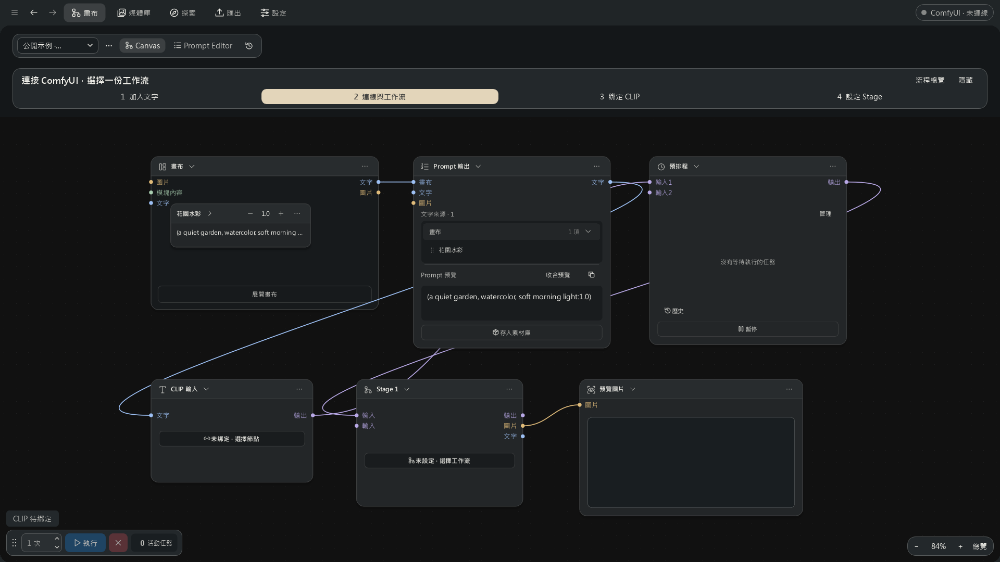
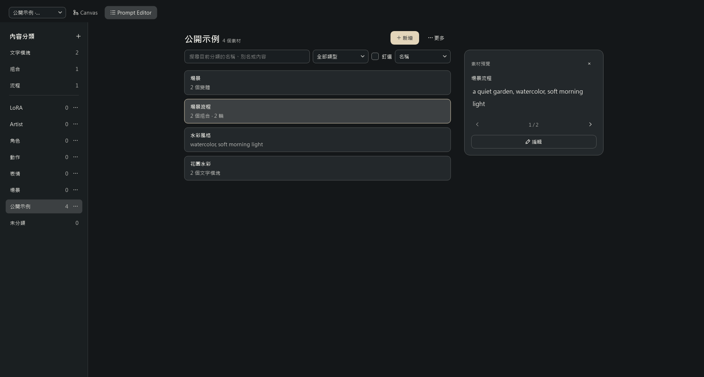

# Prompt Calculus Studio (PCS)

PCS is a Windows desktop tool for reusable prompts and ComfyUI workflows. Keep text variants, combinations and flows in a local library, arrange them on Canvas, and send text and images to your workflows. Prompt editing and copying also work on their own.

[繁體中文](README.md) · [Documentation](docs/README.md)

This source is the **0.8.9 Alpha 1 delivery candidate**. Markdown notes, Canvas workflows and prompt categories share a local tabbed workspace, including split views and an optional sidebar that appears near the left edge. See [setup](docs/guide/workspace-089.md), [changes](docs/releases/0.8.9/alpha.1.md) and [validation limits](docs/releases/0.8.9/validation/alpha.1.md) (Chinese).

## What it does

- Organize named text variants, ordered combinations and flows with repeat settings.
- Prepare batches with fixed Canvas text and multi-round flow readers; shorter sources cycle.
- Bind text fields with CLIP and choose workflows and supported parameters in Stage.
- Queue, pause, cancel and retry tasks while retaining their saved inputs.
- Inspect results in independent image previews, export images and reuse selected outputs.

Generation requires your own ComfyUI installation, models and workflows. Keep PCS, the backend and the workflow browser page open.

## PCS 0.8.8





Actual Qt screens from the fixed 0.8.8 functional source, using isolated public examples with ComfyUI disconnected. See the [capture and validation scope](docs/releases/0.8.8/validation/alpha.1.md) (Chinese).

This release unifies selection and saved progress across text variants, combinations and flows. It adds clearer variant management and side pages, bound-input scheduling and independent image previews. It also fixes whole-workspace cancellation, migrated repeat progress, ordering across output switches, and unnecessary library content in generation snapshots. See the [full release notes](docs/releases/0.8.8/alpha.1.md) (Chinese).

## Download and start

Publication status and available downloads are recorded on [GitHub Releases](https://github.com/gghjkiof36-wq/Prompt-Calculus-Studio/releases). The 0.8.9 package names are:

- `PCS-v0.8.9-Alpha1-source.zip`: source application, bundled extension and installer.
- `PCS-v0.8.9-Alpha1-ComfyUI.zip`: universal extension for manual installation.
- `PCS-v0.8.9-Alpha1-ComfyUI-legacy-0.39.2.zip` or `PCS-v0.8.9-Alpha1-ComfyUI-modern-0.40.0.zip`: alternative compatibility profiles; install one copy only.
- `SHA256SUMS.txt`: download checksums.

Install 64-bit Python 3.12 on Windows. Extract the source archive and open PowerShell beside `run.py`:

```powershell
py -3.12 -m venv .venv
.\.venv\Scripts\python.exe -m pip install -r requirements.txt
.\.venv\Scripts\python.exe run.py --v0.8.9-alpha
```

The first installation downloads dependencies. After that, double-click `Start.cmd`. Available public packages are listed on the Release page; these instructions use the source edition. No Windows executable is publicly distributed in this release.

Update both PCS and its extension. In Explore → ComfyUI → Connection and workflows, choose the extension installer. Close ComfyUI for installation, then restart it and refresh the browser page yourself. Bind CLIP and select a Stage workflow. The [setup](docs/guide/getting-started.md) and [compatibility guide](docs/guide/comfyui-compatibility.md) explain the details (Chinese).

## First use and limits

The current launcher opens the tabbed workspace. New content defaults to `files` beside the program, while settings use `data`; use copies of existing content when upgrading. Large Markdown documents near the 8 MiB limit can still pause during their first reading view. Windows runtime redistribution materials and final independent rechecks remain separate from local developer validation.

Save a text material in Prompt Editor, add a separate copy to Canvas, and copy its Prompt output. For a batch, create combinations and a flow, then connect a flow reader to Prompt output. Canvas text stays fixed within each batch. A ten-round source paired with six rounds produces ten tasks, cycling the shorter source.

Saved tasks consume selection progress even when cancelled: after saving six tasks, the next batch starts at seven. Retry retains the original task values. Previewing does not consume progress, and identical prompts remain separate tasks.

Back up before upgrading and use a data copy. Current documents support schemas 1–7; older applications or extensions may not read new data. Generation metadata still includes necessary prompts and restoration references. Full backups retain the private library, so inspect files before sharing. Some Stage PNGs from older candidates remain unrestorable. Offline checks do not establish new-machine, native desktop, GPU or all third-party node compatibility.

[Guides](docs/guide/README.md) · [Troubleshooting](docs/guide/troubleshooting.md) · [Issues](https://github.com/gghjkiof36-wq/Prompt-Calculus-Studio/issues) · [Contributing](CONTRIBUTING.md) · [Security](SECURITY.md)

## License

[AGPL-3.0-only](LICENSE)
