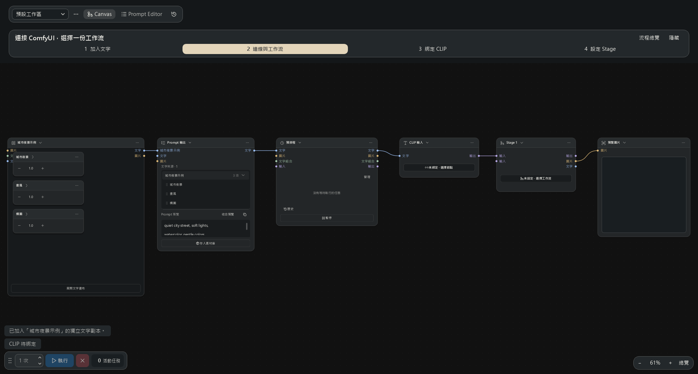
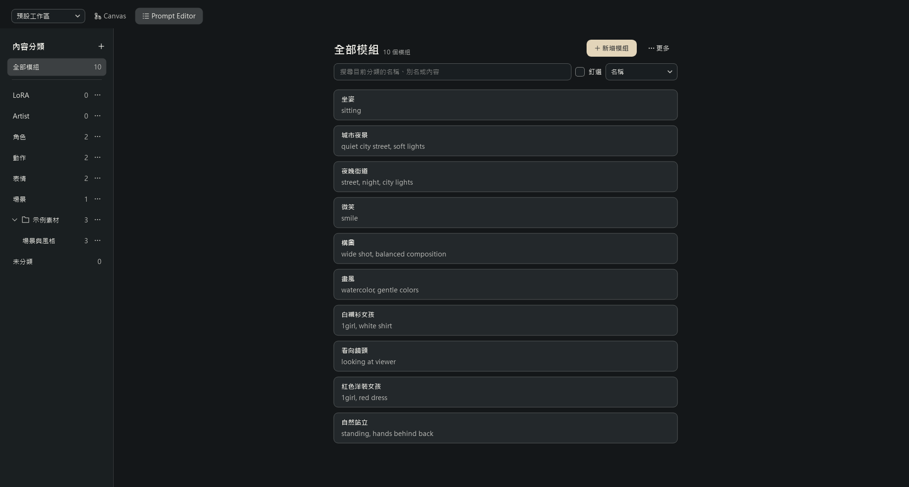

# Prompt Calculus Studio（PCS）

[完整文件目錄：使用指南、版本、測試與歷史紀錄](docs/README.md)

用 Prompt Editor 整理常用文字與素材，在 Canvas 挑選模組、調整順序與權重，再送入 ComfyUI 工作流。PCS 是 Windows 桌面工具，提供 Prompt Editor 與 Canvas 編輯方式，角色、風格、場景與工作區都保存在本機。

**化繁為簡，從混亂中找出秩序。**

[English](README.en.md) · [開始使用](docs/guide/getting-started.md) · [操作指南](docs/guide/README.md) · [ComfyUI 整合](docs/guide/comfyui.md)

## 能做什麼

- **管理文字素材**：在 Prompt Editor 搜尋、釘選與編輯，以資料夾整理分類；Canvas 與 Editor 共用分類瀏覽。
- **組合提示詞**：保存常用文字，調整順序、權重與排除 Tag，隨時加入臨時片段或手動修改。
- **設定每一步的參數**：雙擊 Stage 選取節點，修改 CFG、步數、尺寸或種子；等待中的任務也能各自保存不同設定。
- **安排生成流程**：在 Canvas 用「執行階段（Stage）」選擇工作流，將前一步的圖片送入下一步，設定整串流程重複的次數。
- **預排多組內容**：保存多組提示詞、圖片或生成步驟，依序執行；等待項目可以排序、修改與移除。
- **查看與重用圖片**：查看整批結果、放大預覽、收藏圖片，或將選定圖片交給另一個工作流。

生成圖片需要你自己的 ComfyUI、模型與工作流；只編輯或複製提示詞時，可以單獨使用 PCS。

## Canvas 畫面



0.8.7 實際產品畫面，使用獨立合成示例資料；未連接 ComfyUI。

## Prompt Editor 畫面



實際產品頁面，使用相同隔離範例素材。

## 這版更新

Prompt Editor 集中管理 tags、一般文字與 Markdown，以資料夾整理分類；Canvas 文字挑選沿用同一份分類與收合狀態。加入畫布建立獨立副本，保留素材原件；權重可在卡片上直接輸入，Prompt 輸出可展開来源並排列文字模組。新版也加入框選、多選操作，改善 Prompt、圖片來源、單張載入與預排程的新增頁和預覽。

[完整發布說明](docs/releases/0.8.7/alpha.1.md)

## 下載與啟動

本文件適用：**[0.8.7 Alpha 1](https://github.com/gghjkiof36-wq/Prompt-Calculus-Studio/releases/tag/v0.8.7-alpha.1)**。

| 附件 | 用途 |
|---|---|
| `PCS-v0.8.7-Alpha1-source.zip` | PCS 原始碼版主程式 |
| `PCS-v0.8.7-Alpha1-ComfyUI.zip` | 配套 ComfyUI 擴充，另供手動安裝使用 |
| `SHA256SUMS.txt` | 下載完整性校驗 |

安裝 Windows 64 位元版 Python 3.12，解壓來源包，在包含 `run.py` 的資料夾開啟 PowerShell：

```powershell
py -3.12 -m venv .venv
.\.venv\Scripts\python.exe -m pip install -r requirements.txt
.\.venv\Scripts\python.exe run.py --v0.8.7-alpha
```

首次安裝需要網路下載套件；完成後雙擊來源包內的 `Start.cmd` 即可啟動，也可將它的捷徑放到桌面。本次提供原始碼版，需先安裝 Python，不提供 Windows EXE 下載。

來源包已包含同版配套擴充。開啟 PCS，在「探索 → ComfyUI → 連線與工作流」按「安裝／更新 PCS 擴充」，選 ComfyUI 資料夾；安裝時先關閉 ComfyUI，完成後重啟並重新整理網頁。再依畫布提示綁定 CLIP、選擇 Stage 工作流並執行。生成時保持 PCS、ComfyUI 及工作流網頁開啟。

更新前備份資料，將新版放入新資料夾並使用資料副本。請搭配同版 PCS 與擴充；舊版下載與名稱見[版本對照](docs/releases/README.md)。

## 第一次設定 Stage

雙擊 Canvas 的 Stage 卡片，選工作流和要修改的節點，再按「檢視變更」確認數值並「套用」。套用只保存設定，按「執行」才生成。要比較兩組參數，可在等待項目中分別保存 CFG 3 和 4；後續修改一般 Stage 不會改掉這兩筆設定。完整操作見[Stage 參數指南](docs/guide/stage-parameters.md)。

## 使用提示

- PCS 的文字會在按「執行」時送入 ComfyUI；只有文字輸入、沒有接 Stage 時，只會更新欄位。
- 欄位顯示唯讀時，查看提示原因；更新同版擴充並重啟 ComfyUI、重新整理網頁。已接線或尚不支援的控制可在 ComfyUI 內設定；PCS 可編輯種子上限為 `1125899906842624`。
- 底部叉號取消目前項目，其他等待項保留並暫停。要全部取消，使用叉號右鍵或預排程「更多」中的明確選項。
- 切換工作流後若卡在載入中，先查看 ComfyUI 是否已有任務、保存工作流，再重新整理網頁。處理方式見[疑難排解](docs/guide/troubleshooting.md)。

## 文件與支援

| 想做的事 | 文件 |
|---|---|
| 安裝、啟動與建立捷徑 | [開始使用](docs/guide/getting-started.md) |
| Stage 與每筆任務參數 | [Stage 參數指南](docs/guide/stage-parameters.md) |
| 模組、工作區與圖片操作 | [操作指南](docs/guide/README.md) |
| 綁定工作流與生成 | [ComfyUI 整合](docs/guide/comfyui.md) |
| 資料位置、備份與聯網 | [資料與隱私](docs/guide/data-backup-privacy.md) |
| 查看版本更新 | [發布說明](docs/releases/0.8.7/alpha.1.md)、[更新紀錄](CHANGELOG.md) |
| 回報問題或參與開發 | [Issues](https://github.com/gghjkiof36-wq/Prompt-Calculus-Studio/issues)、[貢獻指南](CONTRIBUTING.md)、[安全回報](SECURITY.md) |

## 授權

[AGPL-3.0-only](LICENSE)
