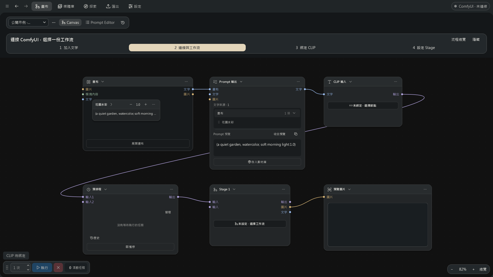
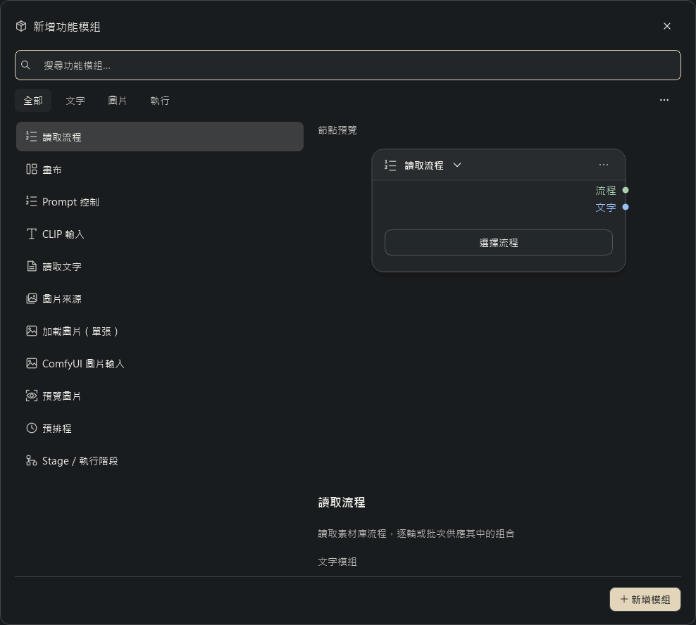
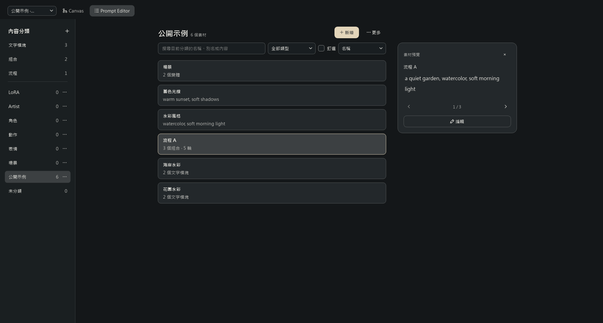
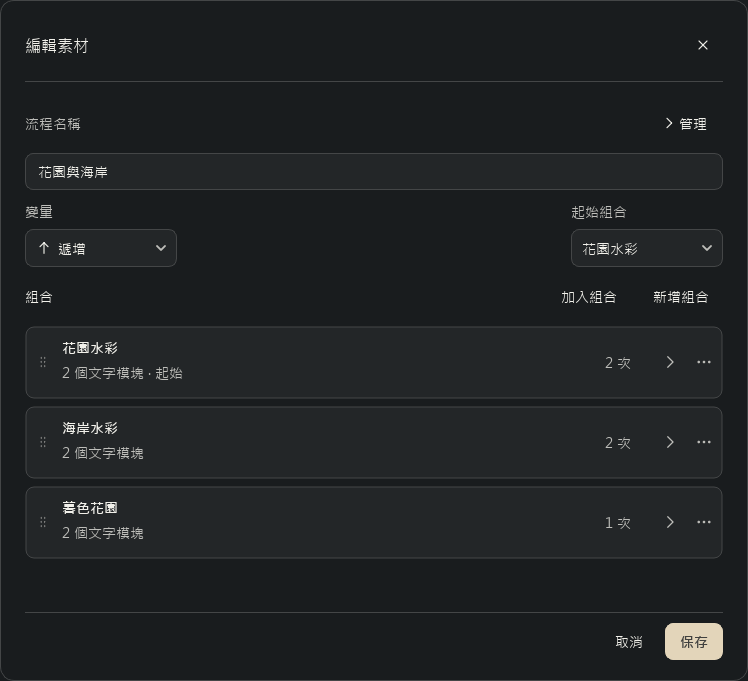

# Prompt Calculus Studio（PCS）

把常用提示詞保存成文字模塊、組合與流程，在 Canvas 安排取值、文字欄位和圖片，再交給 ComfyUI 生成。PCS 是 Windows 桌面工具，素材與工作區保存在本機；只整理或複製 Prompt 時可單獨使用。

**化繁為簡，從混亂中找出秩序。**

[English](README.en.md) · [開始使用](docs/guide/getting-started.md) · [完整文件](docs/README.md) · [0.8.8 更新說明](docs/releases/0.8.8/alpha.1.md)

## 能做什麼

- **整理三層素材**：文字模塊保存命名變體，組合安排文字與權重，流程決定各組的順序與重複次數；可搜尋、釘選及按資料夾分類。
- **一次準備多筆 Prompt**：畫布提供本批固定文字，讀取流程提供多輪；短來源循環，各使用位置獨立保存進度。
- **指定工作流與參數**：CLIP 綁定文字欄位，Stage 選擇生成工作流，編輯 CFG、步數、尺寸及支援的種子；每筆等待任務可保留不同設定。
- **安排與接續任務**：直接執行或先預排程，將前一步圖片交給下一步；暫停、取消、重試及重開保留已保存內容。
- **檢視與重用圖片**：新增獨立圖片預覽，查看批次結果、收藏、匯出，或把選定圖片交給另一個工作流。

生成需要你自己的 ComfyUI、模型與工作流，並保持 PCS、後端和工作流網頁開啟。

## 0.8.8 畫面

### Canvas 串接工作流程

文字經 Prompt 輸出與 CLIP 輸入綁定工作流，再由預排程交給 Stage 執行。



### 雙擊 Canvas 加入功能模組

雙擊 Canvas 空白處，依文字、圖片或執行分類加入模組，右側可先看節點預覽。



### Prompt Editor 預覽素材

雙擊點選素材查看完整 Prompt，右側可以自行添加有關提示詞的圖片。



### 編輯流程

設定組合順序、起始組合與重複次數，將流程保存成可重用素材。



## 這版更新

三層素材共用取值、重複與保存規則，文字由 Prompt 輸出逐筆彙整，再交 CLIP 和 Stage。新版也整理變體管理、右側編輯子頁、素材預覽、綁定後預排程及獨立圖片預覽，改善拖移、窄視窗、回執處理與狀態查詢。取消全部、舊進度遷移、多輸出順序和生成快照的素材範圍均有修正。操作及已知問題見[完整更新說明](docs/releases/0.8.8/alpha.1.md)。

## 下載與啟動

適用：**[0.8.8 Alpha 1](https://github.com/gghjkiof36-wq/Prompt-Calculus-Studio/releases/tag/v0.8.8-alpha.1)**。

| 附件 | 用途 |
|---|---|
| `PCS-v0.8.8-Alpha1-source.zip` | 來源主程式，內含同版配套及安裝腳本 |
| `PCS-v0.8.8-Alpha1-ComfyUI.zip` | 通用配套擴充，另供手動安裝 |
| `PCS-v0.8.8-Alpha1-ComfyUI-legacy-0.39.2.zip`、`PCS-v0.8.8-Alpha1-ComfyUI-modern-0.40.0.zip` | 兩個相容設定檔，擇一安裝；對照版本見[相容指南](docs/guide/comfyui-compatibility.md) |
| `SHA256SUMS.txt` | 下載完整性校驗 |

來源版需要 Windows 64 位元 Python 3.12。在解壓後包含 `run.py` 的資料夾開啟 PowerShell：

```powershell
py -3.12 -m venv .venv
.\.venv\Scripts\python.exe -m pip install -r requirements.txt
.\.venv\Scripts\python.exe run.py --v0.8.8-alpha
```

首次安裝會下載依賴，之後雙擊 `Start.cmd`。公開下載以 Release 附件為準；本指南使用來源版啟動，本次不提供 Windows EXE 公開下載。

要生成圖片，在「探索 → ComfyUI → 連線與工作流」安裝同版 PCS 擴充；安裝前關閉 ComfyUI，完成後由你重新啟動並刷新網頁。再綁定 CLIP、設定 Stage。**主程式與配套都須更新**，重啟舊擴充不會增加新資料格式的支援。詳細步驟見[開始使用](docs/guide/getting-started.md)。

## 第一次使用

在 Prompt Editor 保存一份文字模塊，回 Canvas 加入副本，從 Prompt 輸出複製文字。要做批次，建立組合與流程，再用「讀取流程」接入 Prompt 輸出。畫布在同批使用固定文字；讀取流程逐輪取值。十輪配六輪共十筆，較短者從頭循環，見[素材與批次](docs/guide/prompt-materials-088.md)。

## 使用前留意

- 更新前保留舊程式、舊擴充與原資料，新版使用資料副本。現行文件格式支援 1–7，新資料不能直接交給只支援舊格式的程式。
- 已保存六筆後取消其中四筆，下一批仍接第七筆；重試則沿用原筆內容。相同 Prompt 的任務各自保留。
- 生成 PNG 仍含必要 Prompt 與還原參照，完整備份包含私人素材庫；分享前先[檢查附加資訊](docs/guide/data-backup-privacy.md#分享前)。
- 部分舊候選版的 Stage PNG 仍無法還原，請保留原檔；真實 GPU、新機與所有第三方欄位不在已驗證範圍內。具體處理見[疑難排解](docs/guide/troubleshooting.md)。

[Issues](https://github.com/gghjkiof36-wq/Prompt-Calculus-Studio/issues) · [貢獻指南](CONTRIBUTING.md) · [安全回報](SECURITY.md)

## 授權

[AGPL-3.0-only](LICENSE)
