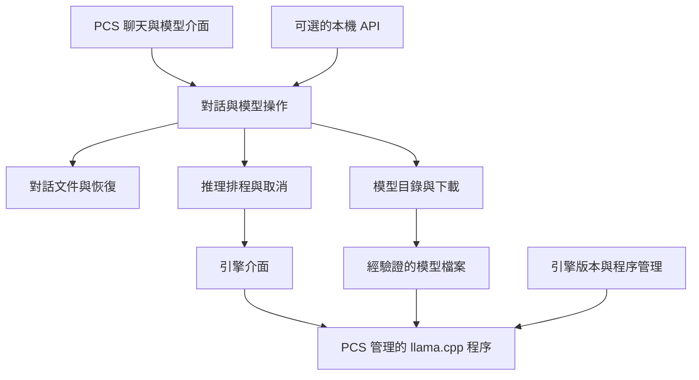

# PCS 內建本地 AI：架構決策稿

2026-10-27 · 目標版本：8.9.10 pre-alpha。**首版介面、探索模型頁與文件／引擎接點已實作；使用者已允許下載及本機運行，固定模型的有界驗證已通過。** 尚非完整 LM Studio 功能或正式發布驗收。

使用者其後要求先統一對話頁骨架，依 01 的空白頁原型及使用者提供的訊息串範例整理。下列離屏畫面結果對應各自記錄的來源；新的對話頁驗證另列於任務執行回執，不以舊畫面宣稱新版驗收。

本稿依使用者最新要求，取代「需另開 LM Studio 的外部服務接入」方向。當前目標是在 PCS 內提供 LM Studio 類型的模型管理、推理、對話及本機 API。GPT／Obsidian 聯動移到後續；本稿只保留清楚的擴充界面，不啟動聯動實作。

## 本批實作與驗證邊界

使用者先授權實作可獨立交互的基礎介面、模型選擇、上下文與生成設定，當時要求完成後先不運行；其後已明確允許下載與本機運行，並選定 DeepSeek-R1-0528-Qwen3-8B Q4_K_M。原先「不運行」限制已由這次授權解除。01 組已撤回外接 LM Studio 前提；GPT／Obsidian 聯動仍在後續。下表分開記錄實作、已取得的證據及未涵蓋範圍。

| 接點 | 已寫入程式 | 待後續驗證或補足 |
| --- | --- | --- |
| `local_documents/chat.py` | `.pcs-chat` v1、草稿、system prompt、多輪與多次回覆、固定參數／歷史關聯、複製新身分、Markdown 匯出 | 18 項文件契約通過；真模型兩輪保存重開完全一致；格式尚未發布 |
| `local_ai/chat_document.py` | 單一文件 owner；保存後才送出；原 request／owner epoch 驗收；停止保留文字；失敗與中斷；1500 ms 保存排程 | 計時為設定值，未量測落盤延遲；IME 或檔案操作暫停保存時延後，失敗保留記憶體稿及既有恢復機制 |
| `local_ai/chat_page.py`、`chat_settings.py` | 同風格對話頁、Markdown／程式碼文字、選取／複製、草稿、多輪、重試、模型操作、上下文及生成設定 | 已以離屏實頁確認建立對話、模型選擇與管理模型返回探索；DPI／IME／長回覆及完整原生互動仍待驗收 |
| `local_ai/model_page.py`、探索入口 | 探索 → 對話模型；加入既有 GGUF、檢視模型位置／大小、明確選用／載入／卸載、開新對話；與對話頁共用應用服務 | 空態／已有模型、1440×900 與 900×760 離屏布局及真按鈕接點通過；開頁、加入與選取不啟動引擎；網路搜尋下載及移除管理留待後續 |
| `local_ai/service.py`、`engine.py` | 應用共用模型服務、獨立工作執行緒、窄引擎 Protocol 與可注入 factory、原請求事件、單一生成與忙碌回覆 | 10 項假服務 owner 與 14 項引擎契約通過；真服務／文件 owner 多輪、停止、卸載通過；未提供使用者排隊、多模型並行、工具或多模態 |
| `local_ai/runtime.py` | 自有 llama-server、Windows Job Object、loopback／臨時認證、健康與身分檢查、串流、token 預檢、停止確認、卸載 | 固定 b11900 Windows CUDA 12.4 x64，官方雜湊、help／version 與所選 R1 模型通過有界運行；不推及任意引擎版本或模型 |
| `local_ai/registry.py` | 引用單一既有 GGUF；讀取檔頭、大小、修改時間；模型 UUID 與設定檔原子保存 | 本次模型另有完整檔案 SHA-256 安裝回執；registry 本身尚無完整 metadata／hash、分片、網路搜尋下載、引擎自動安裝更新 |
| Workspace 整合 | 新增／開啟／分頁／拖曳／搜尋／改名／另存／複製／恢復／關閉的 chat 分支，與 Canvas host 分開 | 離屏真按鈕新增文件、磁碟讀回及跨探索／對話往返通過；其餘跨頁、失敗與原生互動路徑仍需對應回歸 |

啟動入口仍是 PCS 既有工作區入口。原先只做靜態檢查的回執保留為當時紀錄；新增的契約、離屏介面與真模型證據見下節。本次獨立準備模型及引擎，沒有安裝全域 CUDA／pip、建置 EXE 或替換正式安裝。引擎預留 `runtimes/llama.cpp/llama-server.exe`，也可由設定明確選擇固定版本目錄中的檔案；產品內的安裝／更新管理尚未完成，不要求使用者另開 LM Studio。

### 本次受驗來源與結果

契約測試基準為 `f2d0ad9a432a73e4d0b31b6f9bbcb7b7bdcb2e17`。真模型及原探索頁驗證使用該基準加 `runtime.py` 的 `--reasoning-format none` 修改；固定檔案摘要及最後交付提交由任務回執記錄。此參數讓 R1 的思考文字保留在目前支援的 `content` 串流，避免預設 `auto` 將它拆到尚未呈現的 `reasoning_content`。第一版完整保存這些原文，尚未提供獨立的思考區塊介面。

- **42 項有界測試通過**：文件契約 18、假服務 owner 10、引擎／設定與串流契約 14。首次受限執行的 Windows 原子改名失敗保留原始紀錄；相同來源在具備所需本機權限後通過，沒有為此修改產品碼。
- **7 項離屏實頁檢查通過**：探索空態、真 GGUF 登記但不載入、1440×900／900×760 布局、按鈕建立 `.pcs-chat` 並讀回、從對話返回同一探索頁與共用服務、正常關閉。窄窗詳情動作可捲動到達；本輪沒有建立推理 worker。
- **真 `LocalAIService`＋`ChatDocument` smoke 通過**：固定模型載入、兩輪串流與上下文記憶、保存重開一致、停止後保留部分文字並落盤、卸載及自有程序退出。使用隔離資料和無可見 UI 的 Qt 驅動，不能視為原生對話介面的操作驗收。

真模型測試採上下文 2048、回覆上限 384（停止案例 768）、temperature 0.2、top-p 0.9、seed 42、GPU layers 8；只將自有引擎限制於 4 個邏輯 CPU 與低於正常優先序。單次記錄載入 2.782 秒、兩輪各 58.781／41.110 秒；這是保守資源配置下的一次功能檢查，不是冷啟動、首字速度、完整 GPU 加速或效能基準。卸載經自有程序終止完成，回執記退出碼 1，沒有把它記成一般正常退出碼 0。原始回執與畫面連結由任務 STATUS 維護。

離屏檢查首次遇到字庫未自動載入，第二次僅於測試程序加入既有 Windows 字型後取得可讀 PNG；原始圖與 Qt 訊息保留。另有既有 `CanvasNotice` 負尺寸警告，未影響本輪接點。原生 DPI／IME、長文互動、強制當機恢復、OOM、完整效能量測及正式包驗收仍未完成。

### 探索入口與本機介面檢視

依使用者補充，模型匯入與管理集中於既有「探索」頁的「對話模型」入口，與 ComfyUI 模型資產分開。對話頁「管理模型」導向此頁，保留日常模型選擇及載入／卸載。頁面延後至使用者開啟時建立；`local_ai.service.for_workspace` 確保先開模型頁或先開對話都使用同一個 workspace service、registry 與引擎狀態。檢視頁面、選取清單及開新對話都不自動載入模型。

`tools/launch_local_chat_preview.py` 提供本機 BAT 的預覽啟動接點：使用交付目錄下獨立的 files／data／logs，僅在 files／data 皆空時建立空白對話，沿既有工作區入口開啟這份來源。最初靜態回執不再代表本任務尚未允許運行。原生預覽已啟動過，R1 與固定引擎也已排他登記至原先不存在的 preview registry；未覆寫文件或既有模型登記。使用者重新開啟後可讀到新登記，仍須明確按載入。它依賴目前電腦的 Python 與工作樹，不是 EXE 或可攜安裝包；實際路徑與啟動方式以預覽目錄的使用說明為準。

### 對話頁骨架

空白頁與有訊息頁共用一份輸入框、設定入口、模型選單及送出／停止控制。空白頁置中，有訊息後輸入區固定底部；訊息欄以 820px 為最大寬度，窄窗跟隨可用空間。使用者文字靠右成自然寬度氣泡，模型回覆左對齊排正文；重試的舊回覆完整保留並可展開。這些是同一文件的視圖調整，沒有改動 `.pcs-chat` 或 owner／串流契約。

設定收在輸入框左下，模型選單與圓形送出／停止按鈕相鄰於右下；匯出及重試收在頁面右上「⋯」。模型選取不啟動推理，未載入時提供簡短狀態及明確載入操作，模型管理回到探索。上下文與引擎設定在設定頁，不在輸入框外長期鋪說明；真實錯誤、停止與需要重新載入的狀態仍可見。沿 `visual_tokens`、共用圖示與 `RoundMenu.open_for()`，不新增全產品色碼或尺寸規則。

使用者原型是本輪視覺基準。2026-10-27 另對照主流產品官方操作文件：[ChatGPT 將模型選擇放入輸入區](https://help.openai.com/en/articles/6825453-chatgpt-release-notes)、[Claude 將模型選單放在送出旁](https://support.claude.com/en/articles/8664678-change-the-model-effort-and-thinking-settings)、[Gemini 在輸入框底部選擇模型](https://support.google.com/gemini/answer/18648722)、[LM Studio 的明確模型載入步驟](https://lmstudio.ai/docs/app/basics)。這是代表產品的對照，並非全市場調查或像素複製；此輪完成可獨立調整的骨架，不增加未實作的附件、語音或工具入口。

目前逐段輸出使用同一個 worker 的 Qt queued signals 保序，接受端核對完整不可變 ServiceRequest 與本地 owner。尚未實作跨服務重送或序號去重協定，不能把這個同程序事件通道直接作日後公開 API。`profile_epoch` 是模型 UUID 與可攜參數的 UUIDv5 指紋；不是引擎執行階段身分或模型權重 hash。路徑、臨時憑證不寫入對話文件。

本批保存直接沿既有文件 writer 與 CloseRecovery，未另建對話資料庫或增量 journal。舊回覆完整保留；新一輪使用各舊輪最後一次完整回覆，若沒有完整回覆則要求先重試或開新文件，不默默略過。進階分支選擇、舊訊息編輯與恢復 journal 的擴充仍是後續工作。

### 已選定的模型與引擎

使用者已改選 [DeepSeek-R1-0528-Qwen3-8B](https://huggingface.co/deepseek-ai/DeepSeek-R1-0528-Qwen3-8B)。本次採 [Unsloth 的 Q4_K_M GGUF](https://huggingface.co/unsloth/DeepSeek-R1-0528-Qwen3-8B-GGUF/tree/eb48357c179d34dbf515983f798dfb8752a0f261)，固定 revision `eb48357c179d34dbf515983f798dfb8752a0f261`、5,027,785,216 bytes；完整檔案 SHA-256 為 `a86349a4180c4e6bb43f874c29c404fa2be3f90b15509bd6d86f697dba724ec1`，與該 revision 的發布者 LFS 摘要一致。這是明確選定的另一模型，不是 V4.1 的替代命名。

引擎為官方 [llama.cpp b11900](https://github.com/ggml-org/llama.cpp/releases/tag/b11900)，commit `74b104c9ba5717116b7e65e0cd35397778653304`、Windows CUDA 12.4 x64；上游標示 prerelease。引擎及 CUDA DLL 兩個壓縮檔皆核對官方發布 digest，保留來源 manifest、逐檔 hash 與 MIT／LLVM／CUDA 授權文件；`--help`、`--version` 及本次所需參數通過核對。本機 RTX 3080／驅動 591.86 的這個組合已完成上述保守配置的真模型檢查，不推及所有模型、驅動或發布環境。

歷史選型紀錄：先前核對 [DeepSeek V4.1 Flash 官方說明](https://www.deepseek.com/news/deepseek-v4-1-flash/) 與[模型卡](https://huggingface.co/deepseek-ai/DeepSeek-V4.1-Flash)時，標示為 552B MoE、輸入／輸出啟用約 8B／16B。啟用參數不等於總權重，當時未核實「官方 V4.1 約 12B」，也未下載或測試 V4.1；本次 R1 結果不證明 V4.1 相容。

下列章節保留**完整產品的架構目標**；未出現在上述已寫入程式欄的能力，不代表本批已完成。

## 使用者應得到的結果

開啟 PCS，即可搜尋或加入模型、下載、載入、對話、停止、切換與卸載。引擎及依賴由 PCS 的安裝／更新流程管理，不要求使用者開命令列、安裝編譯工具或操作另一個服務程式。已下載模型可離線使用；搜尋、下載與更新顯示其網路活動。

聊天沿現有左側文件樹與分頁，保持目前 PySide6 介面風格。模型管理是應用功能，不再增加第二份聊天歷史側欄。模型庫、對話文件、引擎、憑證各有獨立存放位置。

## 決定：模組化桌面應用，加受控的推理程序

PCS 保留一個桌面應用與明確的內部模組；native 推理由 PCS 自己啟動、監督及關閉的背景程序負責。第一個引擎採 llama.cpp 的 llama-server。這個背景程序是產品隨附元件，不是要求使用者管理外部軟體。

這樣 native 當機可以與編輯器隔離，卸載可由程序退出確認，引擎可以獨立更新與回退。代價是需維護本機傳輸、健康檢查與程序生命週期；這些責任集中在引擎介面與程序管理，不散落到頁面。

不把 llama-cpp-python 的原生 DLL 直接載入 Qt 主程序作為首選；其記憶體生命週期、ABI 與崩潰會更直接影響 PCS。也不先建微服務平台、通用插件市場或多層遠端服務。

## 模組與資料歸屬

| 模組 | 唯一責任 | 不應承擔 |
| --- | --- | --- |
| ChatDocument／ChatSession | 訊息、草稿、選用回覆、請求快照、保存狀態 | 啟動程序、直接拼接 HTTP、管理模型權重 |
| ConversationService | 送出、重試、編輯／重新生成、上下文組裝與預算檢查 | 讀目前焦點來決定回覆目的地 |
| InferenceScheduler | 接受請求、容量、排隊、取消、結果順序與退役 | 檔案匯入／下載、大型雜湊 |
| RuntimeSupervisor | 自有程序、健康狀態、啟停、逾時、崩潰及回收 | 按名稱終止其他應用的服務 |
| EngineAdapter | capabilities、載入、tokenize、stream、cancel、usage | 直接更新聊天 widget 或保存文件 |
| ModelRegistry | 權重身份、metadata、來源、位置、可用性 | 在選取模型時偷偷下載或載入 |
| DownloadManager | 排隊、續傳、取消、驗證、發布完整模型 | 把未完成檔標記可用 |
| RuntimeCatalog | 可用引擎版本、平台能力、安裝驗證與回退 | 啟動時無提示自動升級正在使用的引擎 |
| LocalApiGateway | 明確開關的對外本機 API、認證、限額、回覆 | 暴露內部管理埠或繞過推理排程 |

核心資料與狀態轉換保持不依賴 Qt。UI 用訊號接收投影，背景工作透過結構化事件回報。沿用既有 service_adapters 的不可變請求封套；檔案 Jobs 保留原用途，LLM 有自己的工作執行與容量控制。

## 三個關鍵契約

### 1. 引擎能力與請求

建立窄而明確的 EngineAdapter，先只實作 llama.cpp adapter。能力包含文字、多模態、embedding、工具、模板、上下文、usage 與取消方式；UI 根據引擎和模型共同確認的能力顯示功能，不從模型檔名猜測。

每次推理凍結 conversation ID、message／attempt ID、request ID、owner epoch、來源 revision、模型指紋、引擎版本、參數和實際上下文。引擎切換與設定變更只影響後續請求。引擎的私有 header／server session 不作 PCS 文件身份。

事件統一為 started、delta、usage、finished、failed、cancelled，包含 request ID 與單調序號。資料接受端還要核對原 owner／revision；重複或晚到事件不能寫入另一份文件。

第一個執行策略採一個實際生成槽；首版忙碌時拒絕新請求，後續再提供 UI 排隊與取消排隊。並行模型、批次與多槽只有通過記憶體、取消和公平性驗證後才開放，不能只把數字調大就宣稱支援。

### 2. 對話保存與恢復

對話用真正版本化的 `.pcs-chat` 文件，沿用 PCS envelope、修訂／身份與原子 writer。未完成的草稿 schema 不是已接受的最終格式，需在此契約下調整。

正文、各次回覆與使用者選用的路徑分開保存。重試／重新生成保留舊回覆；編輯舊訊息建立明確的新路徑，不能悄悄改寫後續回覆的來源。執行快照可追溯是哪個模型、參數及上下文產生這次文字。

保存文件是可攜的正式內容；接收中的恢復 journal 是同一份內容的待保存交易，不是另一個獨立聊天資料庫。journal 以文件 ID、基準修訂、operation ID、序號和內容摘要關聯，定期合併到文件；寫入成功回執後才清除對應段。外部修改不自動覆蓋，衝突兩側都保留。

畫面顯示文字不等於磁碟已保存。異常退出最多只能保證恢復到已落盤的檢查點，需量測並公布檢查點間隔。重開將未完成請求標示中斷，不自動重新生成。clone／另存取得新的可寫 owner，原請求不轉交副本。

引擎記憶體中的 KV cache 是加速資料，不作對話真相。程序重啟、模型切換與前綴變更都按 cache key 作廢，保存與重開不依賴它。

### 3. 模型與引擎安裝

模型身份用來源倉庫、固定 revision、檔案集與摘要；名稱只供顯示。GGUF metadata、使用者參數、實際執行參數分開。支援分片檔案集時須全部驗證後才可載入。

下載狀態為 queued → downloading → verifying → ready，另有 paused／cancelled／failed。續傳驗證來源版本、ETag／Range／大小；不匹配就明示重新下載。TLS 保持驗證，下載到專屬暫存，驗證完整後才發布；不覆蓋使用者原有模型。

加入既有模型預設引用其原位置，明確區分「從清單移除」與「刪除實體檔案」。權重不放在使用者文件目錄，不隨聊天複製／匯出。搜尋來源先採 Hugging Face adapter，新增其它來源不改聊天核心。

引擎版本使用經固定與驗證的 manifest，記載來源版本、平台、檔案摘要及相依 runtime。新版本在另一目錄安裝、健康驗證後切換，保留可回退版本。不能跟浮動 main 自動建置正式產品。

## 程序與資源生命週期

模型狀態明列 unloaded、loading、ready、generating、stopping、unloading、failed。按鍵可用性與錯誤回復依狀態轉換，不以多個互相矛盾的布林欄位表示。

Windows 啟動不顯示終端視窗，用自有 process handle 與 Job Object 管理子程序退出；只回收自己啟動的程序。引擎只監聽 loopback，使用每次啟動的認證和握手；port 衝突時重新配置，不任意採用既有服務。程序 stdout／stderr 必須持續、有界地讀取，避免 pipe 堵塞；診斷預設不記聊天正文或憑證。

停止先作廢本次內容接受權，再發取消並確認引擎已閒置。關閉連線不能直接當作 GPU 已停止；超時可結束自有引擎並保留部分回覆。下載、載入、生成和卸載使用各自的取消語義，UI 顯示真實狀態。

GPU／RAM 估算是建議，載入結果才是實際能力。顯示權重、KV cache 與上下文的資源成本，支援明確卸載及閒置卸載設定。PCS 不暗中終止 ComfyUI 或其它 GPU 程序。OOM 保留草稿與訊息，說明可降低上下文／GPU layers 或改用較小模型；不默默修改參數並重送。

上下文預檢採用固定引擎的聊天模板與 tokenizer，保留輸出預算；不得以字數或 UTF-8 bytes 冒稱精確 token。超長時提供使用者可見的處理方式；原對話完整保留，摘要／裁切必須是明確操作。禁止引擎偷偷 context shift 改變送入內容。

## 功能目標與施工順序

這是一個階段內分批完成的範圍，不把第一個能回一句話的版本稱為 LM Studio 功能完成。

| 批次 | 可用成果 | 必要驗收 |
| --- | --- | --- |
| A：執行底座與文件 | PCS 載入既有模型、多輪串流、停止、卸載、保存重開 | 真模型；載入失敗／程序崩潰；取消與晚到事件；同名文件隔離；重開不重送 |
| B：模型管理 | 應用內搜尋、下載、續傳、驗證、加入本機模型、管理磁碟位置 | 斷網、Range 不符、磁碟不足、hash 不符、取消後重開；完整模型才可載入 |
| C：完整聊天操作 | system prompt、參數預設、編輯／重新生成、回覆版本、Markdown／程式碼、匯出、速度與用量 | IME、長文、上下文上限、不同主題／字級／窄窗、草稿／歷史不丟 |
| D：本機 API 與引擎維護 | 明確開關的相容 API、請求排程、引擎更新與回退、診斷 | 認證、限額、API 與 UI 共用模型資源；升級失敗保留舊版本 |
| E：進階模型能力 | 文件問答、embedding／檢索、圖片及工具能力按模型支援接入 | 來源引用可追溯；檢索索引可重建；工具權限與取消邊界；未知能力不假啟用 |

GPT／Obsidian 聯動不在上述批次內。API 與文件介面應可供將來使用，但本階段不替這些整合新增介面或安裝插件。

## 開源參考與取捨

2026-10-26 的架構研究只讀官方 repository／文件；下列 main／master 保留為當時的研究連結。2026-10-27 的實際引擎已另固定為上節 b11900，不把浮動研究連結當作受驗來源。

| 來源 | 採用方向 | PCS 保留的判斷 |
| --- | --- | --- |
| [llama.cpp server](https://github.com/ggml-org/llama.cpp/blob/master/tools/server/README.md) | GGUF 推理、聊天模板、tokenizer、串流、健康與能力接點 | 自有 adapter 固定參數及版本；API 相容不代表所有語義相同 |
| [llama.cpp Windows 發布](https://github.com/ggml-org/llama.cpp/releases) | CPU／CUDA 等可打包引擎來源 | 選型需實機驗證驅動與 runtime；不只根據資產名稱宣告相容 |
| [GPT4All Qt 應用](https://github.com/nomic-ai/gpt4all/tree/main/gpt4all-chat) | UI／推理分離、模型資源管理、下載和版本化聊天 | 沿 PCS PySide6、writer 與 owner，不整套搬入 C++／QML 應用 |
| [Jan worker](https://github.com/janhq/jan/blob/main/src-tauri/plugins/tauri-plugin-llamacpp/src/engine/worker.rs) | 原生推理獨立程序、結構化啟動訊息與 Windows 程序回收 | 保留 PCS 前端；自訂薄 worker 僅在官方 server 無法滿足經測試的取消／生命週期契約時採用 |
| [LM Studio 功能說明](https://lmstudio.ai/docs/app/offline) | 對照模型、離線聊天、本機 API、文件問答與 runtime 維護體驗 | 功能對照用，不作 PCS 的必要執行依賴 |

採用實作前固定來源版本、核對授權告示與相依條件。模型權重、引擎及 GPU runtime 各有自己的分發條件，不能以一份專案 LICENSE 推論全部相同。

Jan 的 [build.rs](https://github.com/janhq/jan/blob/main/src-tauri/plugins/tauri-plugin-llamacpp/build.rs) 提供固定引擎來源版本的參考；[下載 helper](https://github.com/janhq/jan/blob/main/src-tauri/src/core/downloads/helpers.rs) 和 GPT4All 的 [download.cpp](https://github.com/nomic-ai/gpt4all/blob/main/gpt4all-chat/src/download.cpp) 可對照下載、暫存與驗證責任。PCS 的回退 registry、受驗發布與 writer 契約是本稿的設計選擇，不據此聲稱這些專案已實作同一套保證。

自訂 worker 可改善精準取消與握手，但若依賴 llama.cpp 內部 server-context，就增加追蹤上游變動的成本。第一步必須用固定官方 server 做有界原型，核對健康、真正停止、崩潰和退出；不符合才在同一 adapter 後換薄 worker，聊天和文件格式保持不變。

## 與現有 PCS 的接點

- 文件：`workspace_locations`、`workspace_commands`、`workspace_panes`、`local_documents/io`、`identity`、recovery／index／file operations。新增完整 chat 分支，避免借 Canvas host／state。
- 服務：`service_adapters` 沿用不可變封套；專用推理工作不占檔案 `Jobs`。
- UI：`theme.visual_tokens`、既有 settings／StudioDialog、Markdown 與程式碼顯示能力；文件分頁維持單一入口。
- 退出：接 `WorkspaceShell.closeEvent`，先保存草稿／部分回覆，再停止接收與派送，等自己的工作退出後銷毀接收者。
- 既有影像模型管理只有檔案層能力，不把接受 `.gguf` 副檔名當成 LLM 模型管理已完成。

## 架構完成的證據

1. UI thread 不做模型載入、推理、網路下載或大型 hash；真長回覆期間文件操作仍可用。
2. 用可控制的假引擎驗證事件亂序、重複、取消、超時、崩潰和關閉；再以真引擎與固定模型驗證相同契約。
3. 強制中斷自有測試程序後，文件與已落盤 journal 可恢復；外部改檔、clone／另存及重開不串資料。
4. 固定模型、引擎、硬體與上下文，分開記冷啟動、首字延遲、輸出速度、峰值 RAM／VRAM、停止至閒置及卸載至資源釋放。
5. 更新／回退、離線啟動、缺失依賴、不同 DPI／IME 與正式打包均有對應證據；mock／離屏不能替代上述真實驗證。

當前已完成首版介面、文件與自有引擎接點，並取得 42 項契約測試、7 項離屏實頁檢查及固定 R1／b11900 的真多輪、保存、停止與卸載證據。這些證據完成了首版主要接點的有界核對；尚未完成上述全部架構目標、完整 LM Studio 功能、原生互動與效能矩陣或正式發布驗收。舊靜態回執保留，後續以固定來源與受影響範圍補足證據，不將本次單模型結果擴大成全面支援。
