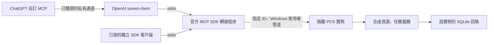

# PCS 合成資源與 MCP 連接 v1

使用者從 ChatGPT 叫用已明選的 PCS 工具。第一階段的資源是兩個固定的合成樣本。設定私有通道是連接操作員的工作，PCS 的使用者流程無須新增 ChatGPT 帳號登入。既有 Chrome 擴充仍負責將使用者在瀏覽器選取的內容送給[原本的保存流程](chrome-connector.md)。



## 啟動及操作

使用 Windows、Python 3.12 與專用虛擬環境，在本工作樹根目錄操作。桌面相依套件見 [requirements](../../requirements.txt)，選用的 MCP 工具相依套件見[專用清單](../../prompt_calculus_studio/mcp_probe/requirements.txt)。標準桌面啟動旗標為 `--v0.8.10-pre-alpha.2`。MCP 需獨立明確啟動。以固定的實例 UUID 及專用空目錄執行下面兩條命令；重開同一目錄時沿用同一 UUID。

```powershell
python -m prompt_calculus_studio.mcp_probe owner --profile C:\A01\synthetic --instance 76dc5b79-50ef-4b3f-a818-64ebf3993ee7
python -m prompt_calculus_studio.mcp_probe stdio --profile C:\A01\synthetic --instance 76dc5b79-50ef-4b3f-a818-64ebf3993ee7
```

第一條在已存在的管理目錄下建立合成 profile。服務預設開啟 15 分鐘，可用 `--minutes 1` 至 `60` 調整。第二條是 MCP 客戶端或隧道啟動的 stdio 命令，工作目錄指向此 checkout。所有工具參數均為業務 ID 或分頁值。Windows 路徑、配對檔與通道憑證由操作員在宿主端設定。

| 工具 | 輸入範例 | 結果 |
| --- | --- | --- |
| `pcs_probe_resources` | `{"limit":1}` | 實例、版本、能力、合成資源、下一頁游標。將游標原樣放入下一次查詢 |
| `pcs_create_test_job` | `{"resource_id":"sample-blue","idempotency_key":"check-001"}` | `data.job.id`、凍結的選區與候選結果 |
| `pcs_get_test_job` | `{"job_id":"取得的 job ID"}` | 原任務與同一份結果 |
| `pcs_cancel_test_job` | 同上 | 本階段任務在接受時即完成，已完成項目回 `already_terminal`，保留其結果 |

正式宿主測試先用實際 ChatGPT 帳號打開外掛程式的「新增自訂 MCP 伺服器」，選「通道」。使用者或管理員在 Platform 將私有通道關聯到目標工作區，使用具有該通道讀取及使用權限的執行憑證啟動官方客戶端，將工作轉給上面的 stdio 命令。通道密鑰由客戶端本機輸入或安全注入。先核對連接顯示的實例與版本，再在 ChatGPT 連續呼叫列資源、建任務、用回傳的 ID 查詢，以及用不存在的 ID 查詢。驗收需同一實例的工具回執與宿主操作證據。[OpenAI 的 ChatGPT 連接說明](https://developers.openai.com/plugins/deploy/connect-chatgpt) · [私有通道文件](https://developers.openai.com/api/docs/guides/secure-mcp-tunnels)

桌面本機 stdio 外掛可以使用同一個轉接程序。其私用安裝取決於桌面宿主與本機執行環境。公開目錄對 desktop-only 提交另有合作方資格。第一階段選擇在已登入的網頁宿主驗證私有通道。[桌面外掛](https://developers.openai.com/plugins/deploy/desktop-only) · [本機安裝](https://developers.openai.com/plugins/build/plugins)

## 資料契約與歸屬

權威型別在 [contracts.py](../../prompt_calculus_studio/mcp_probe/contracts.py)，執行 `python -m prompt_calculus_studio.mcp_probe schemas` 即可取得七種物件各自可獨立驗證的 JSON Schema。全部帶 `schema_version=1`。輸入拒絕未知欄位，來源與任務識別碼不接受路徑。每個實例只有一個明確配對的使用者邊界，多帳號租戶授權需另立契約。

| 型別 | 語義 |
| --- | --- |
| Resource | 穩定 ID、來源身分與種類、邏輯位置、修訂、摘要、可用狀態、能力與資料角色 |
| ContextBundle | 固定版本的來源及選區、分支與訊息引用、排除與缺項、分享模式、實際與上限 bytes。合成任務只使用固定公開樣本 |
| SkillRevision | 獨立修訂、來源、入口、依賴摘要、所需能力、範圍及輸出額度。配方文字不授予工具權限 |
| AgentRevision | 角色、模型選擇、依賴的 Skill 修訂、能力、範圍、成果型別與額度。本次範例的模型值為 null |
| Job | 服務端產生的任務 ID、首次接受的請求 ID、配對身分、冪等鍵及完整輸入指紋，連同資料包、修訂、輸出額度與狀態一併凍結 |
| Result | 所屬任務與成果 ID、候選文字、可定位的引用、實際處理範圍、缺項與實際輸出 bytes |
| Fault | 固定錯誤碼、簡短原因與是否可重試。MCP 的 `isError` 與 `structuredContent.ok` 相互對應 |

原件、管理副本、索引、任務快照、候選、已採用成果各有自己的角色。第一階段中樣本為原件，資料包為快照，輸出為候選。將來正式採用由所屬文件 writer 完成。範圍使用指定來源版本中 Unicode 字元的半開區間。資料包最多 32 個範圍、65,536 bytes，合成任務的輸出額度為 256 bytes。每次列 1 至 2 個資源，尾頁游標為 null。每個 profile 保存最多 128 個任務，到限後仍可查詢及重取既有回執。

任務與成果在同一筆 SQLite 交易完成。「配對主體＋冪等鍵」唯一。重送相同完整輸入取回原 ID 和原回執，變更資源、版本、角色修訂或實例則有獨立的輸入身分。MCP 取消等待或中途斷線時，已接受的提交仍應以相同鍵查明。即時合成任務沒有待執行階段。契約預留 queued／running 的取消意圖和終態區別，真正的模型作業生命週期留待對應階段。

## 通訊及錯誤

轉接端只接受四個固定操作。SDK 負責初始化、版本協商及 stdio framing。當次回應含文字與一致的結構化資料。PCS owner 經 Windows `UserAccessOption` 開啟專用命名管道，使用每次啟動更換的配對密鑰驗證請求及回覆。配對檔由 Windows DPAPI 綁定當前使用者。命令指定的實例 UUID 必須與加密配對及回覆一致。每次請求也核對自己的 ID。這個信任邊界包含同一個已配對 Windows 使用者，適用於私用合成測試。一般資料或多人存取需另做身分驗證與範圍授權。

管道訊框上限 16 KiB，單次連接／讀取有時限，轉接程序最多 8 個在途操作。傳輸只在呼叫時發生。查詢、建立和資料庫錯誤皆回到原呼叫端。

| 狀況 | 可觀察結果 |
| --- | --- |
| PCS 未啟動或已退出 | `service_offline` |
| 無效欄位、錯誤游標、未支援工具 | `invalid_arguments`、`invalid_cursor`、`unsupported` |
| 實例配對不符、密鑰或回覆簽章不符、作業系統拒絕 | `instance_mismatch`、`authentication_failed`、`permission_denied` |
| 沒有該任務、同一鍵不同輸入、已經完成、達容量 | `not_found`、`idempotency_conflict`、`already_terminal`、`capacity` |
| 傳輸逾時、中斷或保存失敗 | `transport_timeout`、`transport_error`、`storage_error`。對未確認的寫入可用原鍵重試 |
| 宿主沒有通道、工作區權限或執行憑證 | 在 ChatGPT／Platform／官方客戶端判定。請求尚未到達 PCS 時，不能由 PCS 回報遠端帳號權限 |

## 既有接點與 LM Studio

MCP 轉接與 [ProbeService](../../prompt_calculus_studio/mcp_probe/service.py) 分離，正常桌面入口按原生命週期啟動。原本 [Chrome 保存服務](../../prompt_calculus_studio/connector_service.py) 有自己的同使用者管道、目的地及使用者接受流程。Markdown、Canvas 和聊天仍各有 writer；將來接入候選採用應沿[現有文件與交易入口](architecture-reference.md)。此階段的工具只操作指定的合成 profile。

| 延伸接點 | 對應 PCS 的現況及責任 |
| --- | --- |
| LM Studio 作 MCP host | 可將此 stdio server 配給相容宿主。本輪已驗證目標 ChatGPT 網頁私人外掛與獨立的官方 SDK 客戶端。LM Studio 本身的連接待另驗。[LM Studio MCP](https://lmstudio.ai/docs/app/mcp) |
| 模型服務與一般生成 | PCS 的 [LocalAIService.submit／cancel](../../prompt_calculus_studio/local_ai/service.py) 管理工作與請求歸屬，[InferenceRuntime](../../prompt_calculus_studio/local_ai/engine.py) 定義啟動、生成、停止及確認空閒。可選 LM Studio adapter 應在 runtime 工廠接入其公開服務。SDK 使用的服務協定需另外協商 |
| 工具迴圈與 guard | LM Studio `.act()` 在模型輪與工具執行前有不同接點。模型輪數不等於工具總數，權限、工具次數、取消及交回仍需 PCS 服務控制。將來 PCS 作 MCP client 呼叫其他工具時，才需要這一側。[固定版本 act.ts](https://github.com/lmstudio-ai/lmstudio-js/blob/4b9af903e866808013524eece1e9ceb7a7f18c68/packages/lms-client/src/llm/act.ts) |
| 前處理與 Tools Provider | 前處理接固定資料包和輸入版本，Tools Provider 提供明確宣告的工具，Generator 才使用生成能力。三者各自有責任。[PromptPreprocessor](https://github.com/lmstudio-ai/lmstudio-js/blob/4b9af903e866808013524eece1e9ceb7a7f18c68/packages/lms-client/src/plugins/processing/PromptPreprocessor.ts) · [ToolsProvider](https://github.com/lmstudio-ai/lmstudio-js/blob/4b9af903e866808013524eece1e9ceb7a7f18c68/packages/lms-client/src/plugins/processing/ToolsProvider.ts) |

上述對照以公開 TypeScript SDK `4b9af903`、Python SDK `16796832` 為參考。兩個 SDK 均為 MIT。採用的是服務邊界與契約，合成路徑由 PCS 自行實作。Windows 工具環境使用官方 MCP Python SDK 1.30.0。這些授權各自適用於所標示的專案。[TS SDK 授權](https://github.com/lmstudio-ai/lmstudio-js/blob/4b9af903e866808013524eece1e9ceb7a7f18c68/LICENSE) · [Python SDK 授權](https://github.com/lmstudio-ai/lmstudio-python/blob/16796832c1665985c73f5a9e938cbf17b40adf02/LICENSE) · [MCP SDK 授權](https://github.com/modelcontextprotocol/python-sdk/blob/main/LICENSE)

[實際程序與宿主相容檢查](../../tests/test_mcp_probe_transport.py)及[資料契約與交易檢查](../../tests/test_mcp_probe_v1.py)使用隔離合成資料。正式 ChatGPT 的四次工具呼叫、實例和結果對照及宿主錯誤語義記於[Pre-alpha2 驗收](../releases/0.8.10/validation/pre-alpha.2.md)。
