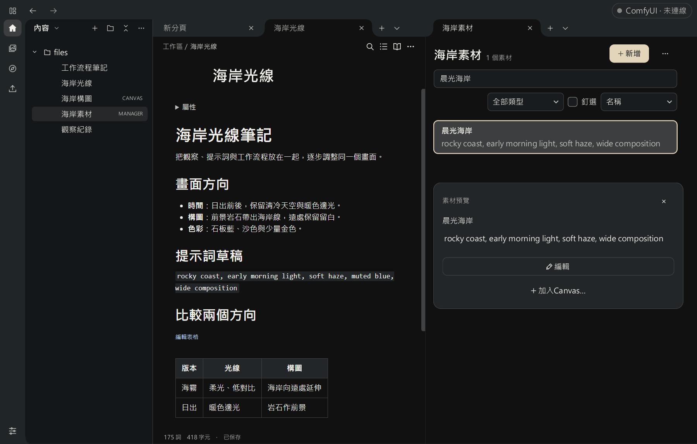
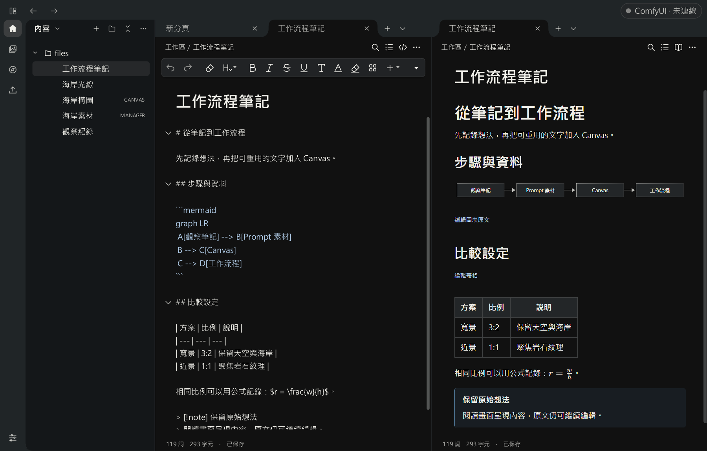
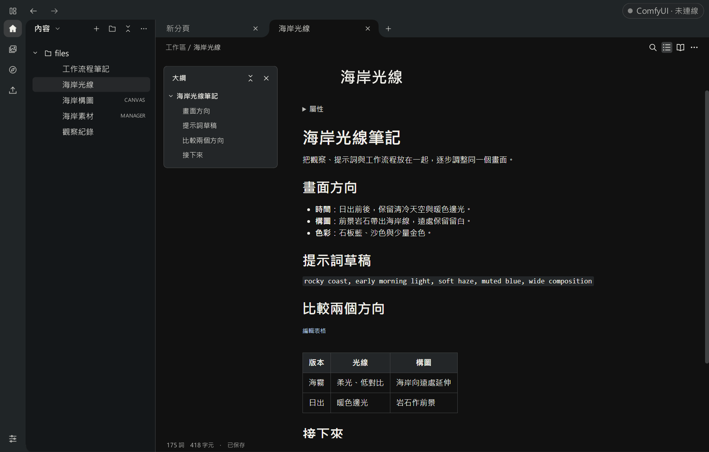
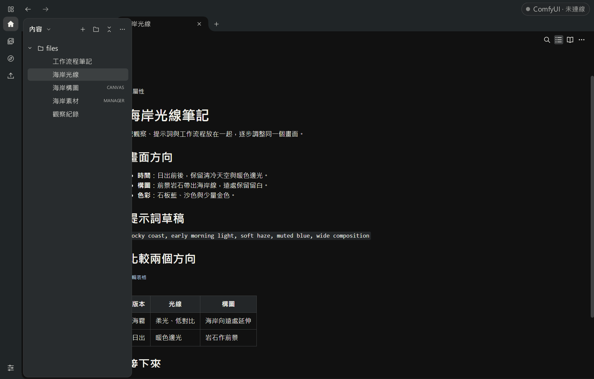

# 0.8.9 Alpha 1：把筆記與工作流程放在一起

[開始使用](../../guide/workspace-089.md) · [驗證與限制](validation/alpha.1.md)

這次更新把 Markdown 筆記、Prompt 素材與 Canvas 放進同一個本機工作區。可以一邊記錄想法，一邊整理提示詞或查看工作流程；需要比較時，把文件分到左右兩邊，不必反覆切換整個畫面。

## 分頁與本機文件

從「內容」新增 Markdown、Prompt 分類或 Canvas，也能加入自己的本機資料夾。文件各自保存，分頁可左右並排；同一份筆記開在兩側時，共用正文與 Undo／Redo，游標與捲動位置各自保留。工作區布局可以命名保存，再切回原來的安排。

新文件預設放在程式旁的 `files`，設定與內部資料放在 `data`。加入既有資料夾是直接開啟其中的文件，編輯也會保存到原位置；初次更新請先使用內容副本。

## Markdown：編寫、原文與閱讀

編寫、原文、閱讀三種視圖可隨時切換。常用格式從工具列插入；表格、連結、圖片、公式、Mermaid 圖表與 PDF 匯出都有對應入口。同一份文件可左邊看原文、右邊看閱讀結果，公式與圖表仍保留可編輯的文字來源。

大綱用標題跳到段落，搜尋／取代處理目前文件；Wiki 連結、筆記嵌入、屬性、標籤與反向連結用來整理文件之間的關係。筆記管理另有全文搜尋、書籤、範本與日誌，版本紀錄可比較及復原內容。

## 側欄與日常操作

收合內容側欄可留出更多編輯空間。游標靠近左側時，側欄暫時浮出，移開後收回，不推動文件或 Canvas。到「設定 → 介面個人化 → 操作行為」可關閉這個功能，或分別調整展開與收回延遲。

這次也整理了側欄的標題、箭頭、圓角與邊緣，修正窄視窗分頁、左右分隔，以及從設定返回工作區只顯示一側的問題。提示框、選單與透明材質的顯示一併調整；素材拖入 Canvas 時，起初經過其他模組也能繼續拖到放置位置。

## 保存與修復

- 保存、引用整理與 PDF 輸出會處理外部檔案改動的衝突，保留可取回的版本；保存途中也保護父資料夾身份，避免目錄被替換後把草稿寫到別處。
- 修正同檔雙視圖關閉一側後，另一側編寫或 Undo 反覆出錯；背景載入、閱讀解析與外部更新不再採用已離開文件的過期結果。
- 切換筆記根時立即使舊索引失效，避免舊結果導向新範圍中的同名筆記。這項已有開發端回歸檢查，尚未取得原提報方對最終版本的獨立確認。
- 部分可明確辨識的舊 Stage PNG，現在可恢復當時實際保存的內容、輸出與綁定；未保存的上游或完整執行進度無法補回，其他不一致快照仍會拒絕。請保留原檔。

## 畫面預覽

以下為 0.8.9 Alpha 1 固定功能來源的實際 Qt 畫面，使用新建合成文件；未連接 ComfyUI。

### 筆記與 Prompt 素材並排

左邊記錄畫面方向，右邊查看與重用提示詞。Markdown、Prompt 分類及 Canvas 都能在工作區開成分頁。



### 同一份文件，左邊原文、右邊閱讀

Mermaid 圖表、表格與公式由原文呈現，不需要另外保存一份預覽稿。



### 用大綱整理長一點的筆記

展開大綱，按標題跳到段落；內容區保留表格、待辦與筆記連結。



### 要找文件時，再叫出側欄

收合後靠近左側即可暫時展開，選完文件再移開游標。浮動面板不改變原來的工作區寬度。



## 下載與啟動

從 [0.8.9 Alpha 1 Release](https://github.com/gghjkiof36-wq/Prompt-Calculus-Studio/releases/tag/v0.8.9-alpha.1) 下載來源主程式、同版通用／legacy／modern ComfyUI 配套及校驗檔。本次不提供 Windows EXE 公開下載。

來源版需要 Windows 64 位元 Python 3.12。完整解壓 `PCS-v0.8.9-Alpha1-source.zip`，在 `run.py` 旁開啟 PowerShell：

```powershell
py -3.12 -m venv .venv
.\.venv\Scripts\python.exe -m pip install -r requirements.txt
.\.venv\Scripts\python.exe run.py --v0.8.9-alpha
```

首次安裝依賴後，可雙擊 `Start.cmd`。要生成圖片，還需要自己的 ComfyUI、模型與工作流，並安裝一份同版 PCS 配套；完成後重新啟動後端與刷新網頁。完整操作見[開始使用](../../guide/workspace-089.md)。

## 使用前留意

- 大型 Markdown 的載入、複雜閱讀與搜尋已有改善，但效能需求尚未全部達標。接近 8 MiB、約 30 萬短段落的固定樣本，首次閱讀仍有約 **1.15 秒主介面停頓**，相較 R2 同樣本約 **0.52 秒反而退步**；複雜內容完整呈現也可能需要數秒。8 MiB 上限沒有調低。
- 更新前保留舊程式、配套與原資料，先以新資料目錄和內容副本試用。完整舊資料庫導入仍有驗證缺口，新舊程式不要同時寫入同一份資料。
- 完整輸入法、DPI、多螢幕、媒體編碼、新機安裝及真實 ComfyUI／GPU 尚未全部驗證。實體上下鍵手感與特定原生退出仍有待確認範圍。
- Windows 本機成品尚未備齊執行環境的完整通知、對應來源及重建替換材料，因此維持本機使用，未列入公開附件。

更細的環境、來源與確認範圍見[驗證與限制](validation/alpha.1.md)。
