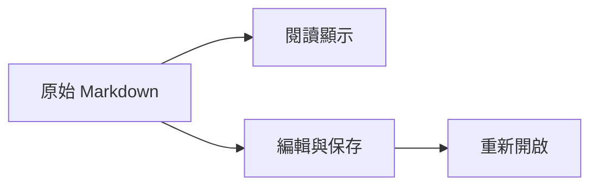

# Markdown、數學與物理相容性測試

這是一份可重複使用的測試文件。請將整個資料夾一起保留，以便測試相對連結、圖片及筆記嵌入。

用途是核對常見 Markdown、Obsidian 核心語法與 LLM 輸出的數學／物理文字；不是承諾所有 LaTeX 套件或 Obsidian 外掛均可執行。一般公式使用 `$…$`、`$$…$$`；後面的反斜線分隔符區另外檢查 LLM 常見的 `\(…\)`、`\[…\]`。

## 驗收順序

- [ ] 閱讀：文字、圖片、表格、公式沒有遺漏或重複。
- [ ] 編寫：進入內容後仍可修改原始語法。
- [ ] 保存：存檔、關閉再重開後，公式與連結一致。
- [ ] 復原：改一個數字後 Undo／Redo，數字能正確來回切換。
- [ ] 可攜：把整個資料夾複製到另一位置，圖片、相對連結、嵌入仍可用。
- [ ] 比對：在 PCS 與 Obsidian 分別閱讀；記錄差異，不能以原文還在就當作顯示成功。

## 01 標題、段落與文字樣式

### 三級標題
#### 四級標題
##### 五級標題
###### 六級標題

一般文字、**粗體**、*斜體*、***粗斜體***、~~刪除線~~、==螢光標示==、`行內程式碼`。

這是一個普通段落。中文與 English、數字 0123456789、標點「」『』（）【】都應保留。

這一段的兩行以普通換行相接，
是否合併受嚴格換行設定影響。

第一行硬換行。  
第二行應另起一行。

HTML 換行前<br>HTML 換行後。

---

## 02 清單、引用、提示與註解

- 第一層項目
  - 第二層項目
    - 第三層項目
- 第二個第一層項目

3. 從第三項開始。
4. 第四項包含 **粗體** 與 $x^2$。

> 引用第一段。
>
> 引用第二段，含 $E=mc^2$。
>
> > 巢狀引用。

> [!note] 一般提示
> 內容應在提示區，並保留 **粗體**。

> [!tip]+ 預設展開
> 展開後可見這一行。

> [!warning]- 預設收合
> 點擊標題後才看見這一行。

可見文字。%% 這段 Obsidian 註解只應在原文中出現。 %%接續可見文字。

<!-- HTML 註解也不應出現在閱讀畫面。 -->

## 03 連結、圖片、腳註與嵌入

[相對連結](輔助筆記.md)、[[輔助筆記]]、[[輔助筆記|顯示別名]]。

[[輔助筆記#連結目標]]、[[輔助筆記#^test-block]]。

[Obsidian 語法說明](https://help.obsidian.md/obsidian-flavored-markdown)、[參照連結][docs]。

[docs]: https://help.obsidian.md/advanced-syntax "進階格式"

這裡有普通腳註[^normal]，以及第二個腳註[^second]。

[^normal]: 普通腳註應可跳轉與返回，並保留 **粗體** 和 $x_i$。
[^second]: 第二個腳註含 [來源連結](https://example.com/)。

下圖應是左紅、右藍的 96×48 測試圖片，不應出現破圖：


指定尺寸的圖片：

Obsidian 圖片嵌入：![[assets/red-blue.png|48]]

嵌入完整筆記：

![[輔助筆記]]

只嵌入指定區塊：

![[輔助筆記#^test-block]]

## 04 表格與精確數值

| 項目 | 內容 | 數值 |
| :--- | :---: | ---: |
| **粗體** | 普通文字 | 001.2300 |
| 根號 | $\sqrt{2}$ | 1.4142135623730951 |
| 科學記號 | $6.02214076\times10^{23}$ | 6.02214076e23 |
| 小數 | $1.0000000000000001$ | 1.0000000000000001 |
| 豎線 | `a\|b` | 9007199254740993 |
| 連結別名 | [[輔助筆記\|別名]] | -0.0000000000000001 |
| 圖片 |  | 299792458 |

預期：欄數不變；前置零、尾隨零、正負號與所有數字逐字保留。不要經浮點數轉換、四捨五入或加千分位。

<table>
<caption>合併儲存格</caption>
<thead><tr><th>類別</th><th>甲</th><th>乙</th></tr></thead>
<tbody><tr><th rowspan="2">同一類</th><td>1.00</td><td>2.00</td></tr><tr><td colspan="2">橫跨兩欄</td></tr></tbody>
</table>

## 05 程式碼、跳脫與字元

這些符號是字面文字，不應變成排版：\*星號\*、\_底線\_、[方括號]、\#井字、\$美元、反斜線 \\。

LLM 常用的公式分隔符若要顯示為字面文字，應放在程式碼中：`\[方括號\]`、`\(圓括號\)`。

行內原文：`\(x^2\)`、`$E=mc^2$`、`\frac{a}{b}`、`[[這不是連結]]`。

```python
sample = r"\[\int_0^1 x^2\,dx\]"
path = r"C:\notes\math.md"
literal = "**not bold** | $100 | [[not a link]]"
```

```text
\(x^2\)
\[\sum_{i=1}^{n}i\]
$$\sqrt{2}$$
%% literal comment %%
```

普通數值：µ μ Ω ω ° Å ± × ÷ ∂ ∇ ∫ ∑ √ ∞ ≈ ≠ ≤ ≥ → ↔ ℏ。

直接文字的上標／下標：m²、m³、s⁻¹、CO₂、H₂O；HTML 的上標／下標：m<sup>2</sup>、x<sub>i</sub>。

貨幣控制：$5 和 $10；US$20.00；跳脫的 \$5。這些不應被當成一段公式。

## 06 圖解



預期：有向圖包含四個節點；圖形只是原文的顯示，不能覆蓋原始 Mermaid 程式碼。


## 07 基本數學、字母與界符

### M001 加減乘除與正負

$$
a+b-c\times d\div e\pm f\mp g
$$

原文：`a+b-c\times d\div e\pm f\mp g`

### M002 分數與連分數

$$
\frac{a+b}{c-d}+\dfrac{1}{1+\cfrac{1}{2+\cfrac{1}{3}}}
$$

原文：`\frac{a+b}{c-d}+\dfrac{1}{1+\cfrac{1}{2+\cfrac{1}{3}}}`

### M003 平方根與 n 次根

$$
\sqrt{x^2+y^2},\qquad\sqrt[3]{8}=2,\qquad\sqrt[n]{a}
$$

原文：`\sqrt{x^2+y^2},\qquad\sqrt[3]{8}=2,\qquad\sqrt[n]{a}`

### M004 上下標與多層索引

$$
x_i^2,\quad a_{ij},\quad e^{-x^2},\quad T^{\mu}_{\ \nu}
$$

原文：`x_i^2,\quad a_{ij},\quad e^{-x^2},\quad T^{\mu}_{\ \nu}`

### M005 希臘字母

$$
\alpha\beta\gamma\delta\epsilon\varepsilon\theta\vartheta\lambda\mu\nu\xi\pi\rho\sigma\tau\phi\varphi\chi\psi\omega
$$

原文：`\alpha\beta\gamma\delta\epsilon\varepsilon\theta\vartheta\lambda\mu\nu\xi\pi\rho\sigma\tau\phi\varphi\chi\psi\omega`

### M006 大寫希臘字母

$$
\Gamma\Delta\Theta\Lambda\Xi\Pi\Sigma\Upsilon\Phi\Psi\Omega
$$

原文：`\Gamma\Delta\Theta\Lambda\Xi\Pi\Sigma\Upsilon\Phi\Psi\Omega`

### M007 集合與邏輯

$$
\forall x\in\mathbb{R},\quad \exists y\in\mathbb{C}:\quad A\subseteq B,\ A\cup B,\ A\cap B,\ \varnothing
$$

原文：`\forall x\in\mathbb{R},\quad \exists y\in\mathbb{C}:\quad A\subseteq B,\ A\cup B,\ A\cap B,\ \varnothing`

### M008 不等式與極限關係

$$
a\ne b,\quad a\le b,\quad a\ge b,\quad a\approx b,\quad a\equiv b\pmod n,\quad a\propto b
$$

原文：`a\ne b,\quad a\le b,\quad a\ge b,\quad a\approx b,\quad a\equiv b\pmod n,\quad a\propto b`

### M009 自動伸縮括號

$$
\left(\frac{a}{b}\right),\quad\left[\sum_{i=1}^n i\right],\quad\left\langle\psi\middle|\phi\right\rangle
$$

原文：`\left(\frac{a}{b}\right),\quad\left[\sum_{i=1}^n i\right],\quad\left\langle\psi\middle|\phi\right\rangle`

### M010 絕對值與範數

$$
|x|,\quad\lvert x\rvert,\quad\lVert\mathbf{v}\rVert_2,\quad\lfloor x\rfloor,\quad\lceil x\rceil
$$

原文：`|x|,\quad\lvert x\rvert,\quad\lVert\mathbf{v}\rVert_2,\quad\lfloor x\rfloor,\quad\lceil x\rceil`

### M011 三角、指數與對數

$$
\sin^2\theta+\cos^2\theta=1,\quad e^{i\pi}+1=0,\quad\ln x,\quad\log_{10}x,\quad\exp(x)
$$

原文：`\sin^2\theta+\cos^2\theta=1,\quad e^{i\pi}+1=0,\quad\ln x,\quad\log_{10}x,\quad\exp(x)`

### M012 複數與共軛

$$
z=a+bi,\quad\overline{z}=a-bi,\quad\operatorname{Re}z=a,\quad\operatorname{Im}z=b
$$

原文：`z=a+bi,\quad\overline{z}=a-bi,\quad\operatorname{Re}z=a,\quad\operatorname{Im}z=b`

## 08 微分、積分、級數

### M013 普通微分

$$
\frac{\mathrm{d}y}{\mathrm{d}x}=\lim_{h\to0}\frac{f(x+h)-f(x)}{h}
$$

原文：`\frac{\mathrm{d}y}{\mathrm{d}x}=\lim_{h\to0}\frac{f(x+h)-f(x)}{h}`

### M014 高階導數與撇號

$$
f^{\prime}(x),\quad f^{\prime\prime}(x),\quad\frac{\mathrm{d}^n f}{\mathrm{d}x^n}
$$

原文：`f^{\prime}(x),\quad f^{\prime\prime}(x),\quad\frac{\mathrm{d}^n f}{\mathrm{d}x^n}`

### M015 時間微分

$$
\dot{x}=\frac{\mathrm{d}x}{\mathrm{d}t},\quad\ddot{x}=\frac{\mathrm{d}^2x}{\mathrm{d}t^2}
$$

原文：`\dot{x}=\frac{\mathrm{d}x}{\mathrm{d}t},\quad\ddot{x}=\frac{\mathrm{d}^2x}{\mathrm{d}t^2}`

### M016 偏微分與混合偏導

$$
\frac{\partial f}{\partial x},\quad\frac{\partial^2 f}{\partial x\partial y},\quad\partial_\mu\phi
$$

原文：`\frac{\partial f}{\partial x},\quad\frac{\partial^2 f}{\partial x\partial y},\quad\partial_\mu\phi`

### M017 全微分

$$
\mathrm{d}f=\frac{\partial f}{\partial x}\,\mathrm{d}x+\frac{\partial f}{\partial y}\,\mathrm{d}y
$$

原文：`\mathrm{d}f=\frac{\partial f}{\partial x}\,\mathrm{d}x+\frac{\partial f}{\partial y}\,\mathrm{d}y`

### M018 不定積分

$$
\int x^n\,\mathrm{d}x=\frac{x^{n+1}}{n+1}+C\quad(n\ne-1)
$$

原文：`\int x^n\,\mathrm{d}x=\frac{x^{n+1}}{n+1}+C\quad(n\ne-1)`

### M019 定積分

$$
\int_0^1 x^2\,\mathrm{d}x=\frac{1}{3}
$$

原文：`\int_0^1 x^2\,\mathrm{d}x=\frac{1}{3}`

### M020 反常積分

$$
\int_{-\infty}^{\infty}e^{-x^2}\,\mathrm{d}x=\sqrt{\pi}
$$

原文：`\int_{-\infty}^{\infty}e^{-x^2}\,\mathrm{d}x=\sqrt{\pi}`

### M021 二重與三重積分

$$
\iint_D f(x,y)\,\mathrm{d}A,\qquad\iiint_V\rho\,\mathrm{d}V
$$

原文：`\iint_D f(x,y)\,\mathrm{d}A,\qquad\iiint_V\rho\,\mathrm{d}V`

### M022 線積分與閉合積分

$$
\int_C\mathbf{F}\cdot\mathrm{d}\mathbf{r},\qquad\oint_C\mathbf{F}\cdot\mathrm{d}\mathbf{r}
$$

原文：`\int_C\mathbf{F}\cdot\mathrm{d}\mathbf{r},\qquad\oint_C\mathbf{F}\cdot\mathrm{d}\mathbf{r}`

### M023 求和 Sigma

$$
\sum_{i=1}^{n}i=\frac{n(n+1)}{2}
$$

原文：`\sum_{i=1}^{n}i=\frac{n(n+1)}{2}`

### M024 連乘 Pi

$$
\prod_{k=1}^{n}k=n!
$$

原文：`\prod_{k=1}^{n}k=n!`

### M025 泰勒級數

$$
e^x=\sum_{n=0}^{\infty}\frac{x^n}{n!}
$$

原文：`e^x=\sum_{n=0}^{\infty}\frac{x^n}{n!}`

### M026 極限

$$
\lim_{x\to0}\frac{\sin x}{x}=1,\qquad\lim_{n\to\infty}\left(1+\frac1n\right)^n=e
$$

原文：`\lim_{x\to0}\frac{\sin x}{x}=1,\qquad\lim_{n\to\infty}\left(1+\frac1n\right)^n=e`

### M027 鏈鎖法則

$$
\frac{\mathrm{d}}{\mathrm{d}x}f(g(x))=f^{\prime}(g(x))\,g^{\prime}(x)
$$

原文：`\frac{\mathrm{d}}{\mathrm{d}x}f(g(x))=f^{\prime}(g(x))\,g^{\prime}(x)`

## 09 向量、矩陣與線性代數

### M028 向量與單位向量

$$
\vec{v}=v_x\hat{\mathbf{x}}+v_y\hat{\mathbf{y}}+v_z\hat{\mathbf{z}}
$$

原文：`\vec{v}=v_x\hat{\mathbf{x}}+v_y\hat{\mathbf{y}}+v_z\hat{\mathbf{z}}`

### M029 點積與叉積

$$
\mathbf{a}\cdot\mathbf{b}=ab\cos\theta,\quad\mathbf{a}\times\mathbf{b}=ab\sin\theta\,\hat{\mathbf{n}}
$$

原文：`\mathbf{a}\cdot\mathbf{b}=ab\cos\theta,\quad\mathbf{a}\times\mathbf{b}=ab\sin\theta\,\hat{\mathbf{n}}`

### M030 基底旋轉

$$
\mathbf{e}_x\longrightarrow(\cos\theta,\sin\theta),\quad\mathbf{e}_y\longrightarrow(-\sin\theta,\cos\theta)
$$

原文：`\mathbf{e}_x\longrightarrow(\cos\theta,\sin\theta),\quad\mathbf{e}_y\longrightarrow(-\sin\theta,\cos\theta)`

### M031 二維旋轉矩陣

$$
R(\theta)=\begin{pmatrix}\cos\theta&-\sin\theta\\\sin\theta&\cos\theta\end{pmatrix}
$$

原文：`R(\theta)=\begin{pmatrix}\cos\theta&-\sin\theta\\\sin\theta&\cos\theta\end{pmatrix}`

### M032 三維矩陣

$$
A=\begin{bmatrix}a_{11}&a_{12}&a_{13}\\a_{21}&a_{22}&a_{23}\\a_{31}&a_{32}&a_{33}\end{bmatrix}
$$

原文：`A=\begin{bmatrix}a_{11}&a_{12}&a_{13}\\a_{21}&a_{22}&a_{23}\\a_{31}&a_{32}&a_{33}\end{bmatrix}`

### M033 行列式

$$
\begin{vmatrix}a&b\\c&d\end{vmatrix}=ad-bc
$$

原文：`\begin{vmatrix}a&b\\c&d\end{vmatrix}=ad-bc`

### M034 轉置、逆矩陣與厄米共軛

$$
A^{\mathsf{T}},\quad A^{-1},\quad A^{\dagger}=(\overline{A})^{\mathsf{T}}
$$

原文：`A^{\mathsf{T}},\quad A^{-1},\quad A^{\dagger}=(\overline{A})^{\mathsf{T}}`

### M035 特徵值

$$
A\mathbf{v}=\lambda\mathbf{v},\qquad\det(A-\lambda I)=0
$$

原文：`A\mathbf{v}=\lambda\mathbf{v},\qquad\det(A-\lambda I)=0`

### M036 分段函數

$$
f(x)=\begin{cases}x^2,&x\ge0,\\-x,&x<0.\end{cases}
$$

原文：`f(x)=\begin{cases}x^2,&x\ge0,\\-x,&x<0.\end{cases}`

### M037 對齊多行公式

$$
\begin{aligned}a&=b+c\\&=d+e\\f(x)&=x^2+1\end{aligned}
$$

原文：`\begin{aligned}a&=b+c\\&=d+e\\f(x)&=x^2+1\end{aligned}`

### M038 聯立方程

$$
\left\{\begin{aligned}2x+y&=5\\x-y&=1\end{aligned}\right.
$$

原文：`\left\{\begin{aligned}2x+y&=5\\x-y&=1\end{aligned}\right.`

### M039 Jacobian

$$
J=\frac{\partial(u,v)}{\partial(x,y)}=\begin{pmatrix}\frac{\partial u}{\partial x}&\frac{\partial u}{\partial y}\\\frac{\partial v}{\partial x}&\frac{\partial v}{\partial y}\end{pmatrix}
$$

原文：`J=\frac{\partial(u,v)}{\partial(x,y)}=\begin{pmatrix}\frac{\partial u}{\partial x}&\frac{\partial u}{\partial y}\\\frac{\partial v}{\partial x}&\frac{\partial v}{\partial y}\end{pmatrix}`

## 10 物理與向量微積分

### M040 梯度

$$
\nabla f=\left(\frac{\partial f}{\partial x},\frac{\partial f}{\partial y},\frac{\partial f}{\partial z}\right)
$$

原文：`\nabla f=\left(\frac{\partial f}{\partial x},\frac{\partial f}{\partial y},\frac{\partial f}{\partial z}\right)`

### M041 散度

$$
\nabla\cdot\mathbf{F}=\frac{\partial F_x}{\partial x}+\frac{\partial F_y}{\partial y}+\frac{\partial F_z}{\partial z}
$$

原文：`\nabla\cdot\mathbf{F}=\frac{\partial F_x}{\partial x}+\frac{\partial F_y}{\partial y}+\frac{\partial F_z}{\partial z}`

### M042 旋度

$$
\nabla\times\mathbf{F}=\begin{vmatrix}\hat{\mathbf{x}}&\hat{\mathbf{y}}&\hat{\mathbf{z}}\\\partial_x&\partial_y&\partial_z\\F_x&F_y&F_z\end{vmatrix}
$$

原文：`\nabla\times\mathbf{F}=\begin{vmatrix}\hat{\mathbf{x}}&\hat{\mathbf{y}}&\hat{\mathbf{z}}\\\partial_x&\partial_y&\partial_z\\F_x&F_y&F_z\end{vmatrix}`

### M043 Laplacian

$$
\nabla^2\phi=\frac{\partial^2\phi}{\partial x^2}+\frac{\partial^2\phi}{\partial y^2}+\frac{\partial^2\phi}{\partial z^2}
$$

原文：`\nabla^2\phi=\frac{\partial^2\phi}{\partial x^2}+\frac{\partial^2\phi}{\partial y^2}+\frac{\partial^2\phi}{\partial z^2}`

### M044 散度定理

$$
\iiint_V\nabla\cdot\mathbf{F}\,\mathrm{d}V=\iint_{\partial V}\mathbf{F}\cdot\hat{\mathbf{n}}\,\mathrm{d}S
$$

原文：`\iiint_V\nabla\cdot\mathbf{F}\,\mathrm{d}V=\iint_{\partial V}\mathbf{F}\cdot\hat{\mathbf{n}}\,\mathrm{d}S`

### M045 Stokes 定理

$$
\iint_S(\nabla\times\mathbf{F})\cdot\hat{\mathbf{n}}\,\mathrm{d}S=\oint_{\partial S}\mathbf{F}\cdot\mathrm{d}\mathbf{r}
$$

原文：`\iint_S(\nabla\times\mathbf{F})\cdot\hat{\mathbf{n}}\,\mathrm{d}S=\oint_{\partial S}\mathbf{F}\cdot\mathrm{d}\mathbf{r}`

### M046 牛頓運動與動能

$$
\mathbf{F}=m\mathbf{a},\quad\mathbf{p}=m\mathbf{v},\quad K=\frac12mv^2
$$

原文：`\mathbf{F}=m\mathbf{a},\quad\mathbf{p}=m\mathbf{v},\quad K=\frac12mv^2`

### M047 振動與阻尼

$$
m\ddot{x}+b\dot{x}+kx=F_0\cos(\omega t)
$$

原文：`m\ddot{x}+b\dot{x}+kx=F_0\cos(\omega t)`

### M048 Euler–Lagrange 方程

$$
\frac{\mathrm{d}}{\mathrm{d}t}\frac{\partial L}{\partial\dot{q}_i}-\frac{\partial L}{\partial q_i}=0
$$

原文：`\frac{\mathrm{d}}{\mathrm{d}t}\frac{\partial L}{\partial\dot{q}_i}-\frac{\partial L}{\partial q_i}=0`

### M049 Hamilton 方程

$$
\dot{q}_i=\frac{\partial H}{\partial p_i},\qquad\dot{p}_i=-\frac{\partial H}{\partial q_i}
$$

原文：`\dot{q}_i=\frac{\partial H}{\partial p_i},\qquad\dot{p}_i=-\frac{\partial H}{\partial q_i}`

### M050 Maxwell 方程

$$
\begin{aligned}\nabla\cdot\mathbf{E}&=\rho/\varepsilon_0\\\nabla\cdot\mathbf{B}&=0\\\nabla\times\mathbf{E}&=-\partial_t\mathbf{B}\\\nabla\times\mathbf{B}&=\mu_0\mathbf{J}+\mu_0\varepsilon_0\partial_t\mathbf{E}\end{aligned}
$$

原文：`\begin{aligned}\nabla\cdot\mathbf{E}&=\rho/\varepsilon_0\\\nabla\cdot\mathbf{B}&=0\\\nabla\times\mathbf{E}&=-\partial_t\mathbf{B}\\\nabla\times\mathbf{B}&=\mu_0\mathbf{J}+\mu_0\varepsilon_0\partial_t\mathbf{E}\end{aligned}`

### M051 波動方程

$$
\frac{\partial^2u}{\partial t^2}=c^2\nabla^2u
$$

原文：`\frac{\partial^2u}{\partial t^2}=c^2\nabla^2u`

### M052 Schrödinger 方程

$$
i\hbar\frac{\partial\psi}{\partial t}=\left(-\frac{\hbar^2}{2m}\nabla^2+V\right)\psi
$$

原文：`i\hbar\frac{\partial\psi}{\partial t}=\left(-\frac{\hbar^2}{2m}\nabla^2+V\right)\psi`

### M053 量子態與對易子

$$
\langle\psi|\hat{A}|\psi\rangle,\quad[\hat{x},\hat{p}]=i\hbar,\quad\Delta x\,\Delta p\ge\frac{\hbar}{2}
$$

原文：`\langle\psi|\hat{A}|\psi\rangle,\quad[\hat{x},\hat{p}]=i\hbar,\quad\Delta x\,\Delta p\ge\frac{\hbar}{2}`

### M054 相對論

$$
E^2=p^2c^2+m^2c^4,\qquad\gamma=\frac{1}{\sqrt{1-v^2/c^2}}
$$

原文：`E^2=p^2c^2+m^2c^4,\qquad\gamma=\frac{1}{\sqrt{1-v^2/c^2}}`

### M055 熱力學

$$
\mathrm{d}U=T\,\mathrm{d}S-p\,\mathrm{d}V+\mu\,\mathrm{d}N
$$

原文：`\mathrm{d}U=T\,\mathrm{d}S-p\,\mathrm{d}V+\mu\,\mathrm{d}N`

### M056 Gibbs 熵

$$
S=-k_{\mathrm{B}}\sum_i p_i\ln p_i
$$

原文：`S=-k_{\mathrm{B}}\sum_i p_i\ln p_i`

### M057 Poisson 括號

$$
\{f,g\}=\sum_i\left(\frac{\partial f}{\partial q_i}\frac{\partial g}{\partial p_i}-\frac{\partial f}{\partial p_i}\frac{\partial g}{\partial q_i}\right)
$$

原文：`\{f,g\}=\sum_i\left(\frac{\partial f}{\partial q_i}\frac{\partial g}{\partial p_i}-\frac{\partial f}{\partial p_i}\frac{\partial g}{\partial q_i}\right)`

## 11 機率、統計、工程與單位

### M058 機率與條件機率

$$
P(A\mid B)=\frac{P(A\cap B)}{P(B)}
$$

原文：`P(A\mid B)=\frac{P(A\cap B)}{P(B)}`

### M059 平均、變異與標準差

$$
\bar{x}=\frac1n\sum_{i=1}^n x_i,\quad\sigma^2=\mathbb{E}[(X-\mu)^2],\quad\sigma=\sqrt{\sigma^2}
$$

原文：`\bar{x}=\frac1n\sum_{i=1}^n x_i,\quad\sigma^2=\mathbb{E}[(X-\mu)^2],\quad\sigma=\sqrt{\sigma^2}`

### M060 常態分布

$$
f(x)=\frac{1}{\sigma\sqrt{2\pi}}\exp\left(-\frac{(x-\mu)^2}{2\sigma^2}\right)
$$

原文：`f(x)=\frac{1}{\sigma\sqrt{2\pi}}\exp\left(-\frac{(x-\mu)^2}{2\sigma^2}\right)`

### M061 二項係數

$$
\binom{n}{k}=\frac{n!}{k!(n-k)!}
$$

原文：`\binom{n}{k}=\frac{n!}{k!(n-k)!}`

### M062 Fourier 轉換

$$
\hat{f}(\omega)=\int_{-\infty}^{\infty}f(t)e^{-i\omega t}\,\mathrm{d}t
$$

原文：`\hat{f}(\omega)=\int_{-\infty}^{\infty}f(t)e^{-i\omega t}\,\mathrm{d}t`

### M063 Laplace 轉換

$$
F(s)=\int_0^\infty f(t)e^{-st}\,\mathrm{d}t
$$

原文：`F(s)=\int_0^\infty f(t)e^{-st}\,\mathrm{d}t`

### M064 電路阻抗

$$
Z_R=R,\quad Z_L=i\omega L,\quad Z_C=\frac{1}{i\omega C}
$$

原文：`Z_R=R,\quad Z_L=i\omega L,\quad Z_C=\frac{1}{i\omega C}`

### M065 微小量與有效位數

$$
1.2300\times10^{-9}\,\mathrm{m},\qquad 6.02214076\times10^{23}\,\mathrm{mol}^{-1}
$$

原文：`1.2300\times10^{-9}\,\mathrm{m},\qquad 6.02214076\times10^{23}\,\mathrm{mol}^{-1}`

### M066 工程單位

$$
9.80665\,\mathrm{m\,s^{-2}},\quad 1.00\,\mathrm{k\Omega},\quad 2.20\,\mu\mathrm{F},\quad 25.0\,{}^{\circ}\mathrm{C}
$$

原文：`9.80665\,\mathrm{m\,s^{-2}},\quad 1.00\,\mathrm{k\Omega},\quad 2.20\,\mu\mathrm{F},\quad 25.0\,{}^{\circ}\mathrm{C}`

### M067 不確定度

$$
L=(12.340\pm0.005)\,\mathrm{mm},\qquad \frac{\Delta L}{L}=4.05\times10^{-4}
$$

原文：`L=(12.340\pm0.005)\,\mathrm{mm},\qquad \frac{\Delta L}{L}=4.05\times10^{-4}`

### M068 量綱

$$
[F]=\mathsf{M}\mathsf{L}\mathsf{T}^{-2},\qquad [E]=\mathsf{M}\mathsf{L}^{2}\mathsf{T}^{-2}
$$

原文：`[F]=\mathsf{M}\mathsf{L}\mathsf{T}^{-2},\qquad [E]=\mathsf{M}\mathsf{L}^{2}\mathsf{T}^{-2}`

### M069 百分比、符號與中文

$$
\eta=98.50\%,\qquad\text{誤差}\le0.01\,\mathrm{mm}
$$

原文：`\eta=98.50\%,\qquad\text{誤差}\le0.01\,\mathrm{mm}`


## 12 行內公式與不同分隔符

行內公式要與文字同一行：$x_i^2$、$\frac{1}{2}$、$\sqrt{3}$、$\partial_t\psi$、$\nabla\cdot\mathbf{F}$、$\Sigma$、$\sum_{i=1}^n i$。

LLM 常見行內分隔符：\(R(90^\circ)\)、\(\mathbf{e}_x\)、\(\int_0^1x^2\,\mathrm{d}x\)。

LLM 常見單行顯示公式：

\[ R(\theta)=\begin{pmatrix}\cos\theta&-\sin\theta\\\sin\theta&\cos\theta\end{pmatrix} \]

LLM 常見多行顯示公式：

\[
\begin{aligned}
\mathbf{v}&=x\mathbf{e}_x+y\mathbf{e}_y\\
T(\mathbf{v})&=xT(\mathbf{e}_x)+yT(\mathbf{e}_y)
\end{aligned}
\]

1. 清單內行內公式 \(x^2+y^2=r^2\)。
2. 清單內顯示公式：

   \[
   \sum_{i=1}^{n}i=\frac{n(n+1)}2
   \]

> 引用內顯示公式：
>
> \[
> E=mc^2
> \]

## 13 異常與不支援語法的控制組

這一節刻意保留原文。不要自動刪除它們，也不要猜測其數學意思。

未閉合的行內公式：\(x+1

未閉合的美元公式：$x+1

未閉合的顯示公式：

\[
x+1

以下是套件或自訂指令，僅作字面資料保留；這份測試不要求把它們冒充已成功排版：

```latex
\usepackage{physics}
\dv{x}{t}
\pdv{f}{x}
\qty(\frac{a}{b})
\SI{9.81}{\metre\per\second\squared}
\ce{H2O}
\begin{tikzpicture} ... \end{tikzpicture}
```

若需要這類功能，應另外選定套件相容範圍。GeoGebra 類互動數學工具也屬另一項功能，不把靜態公式等同互動模型。

## 14 保存、還原與原文比對

修改用數值：`001.2300`、`9007199254740993`、`-0.0000000000000001`。

修改用公式：$a_{12}=1.0000000000000001$。

先記下原文，再修改其中一個數字、保存、關閉、重新開啟，核對沒有轉換數字或吞掉反斜線。接著測試 Undo／Redo；這應恢復本次編輯，不能誤改別的檔案。

## 參考與邊界

- [Obsidian 核心 Markdown 語法](https://help.obsidian.md/obsidian-flavored-markdown)
- [Obsidian 進階格式與 MathJax](https://help.obsidian.md/advanced-syntax)
- [PCS 目前採用的 KaTeX 支援列表](https://katex.org/docs/supported.html)

Obsidian 使用 MathJax，PCS 此版本使用本機 KaTeX。兩者共有大量數學語法，但套件、巨集及邊界行為並不完全一致。此文件涵蓋常見格式與代表性邊界，不能窮舉任意使用者自訂的數學指令。
