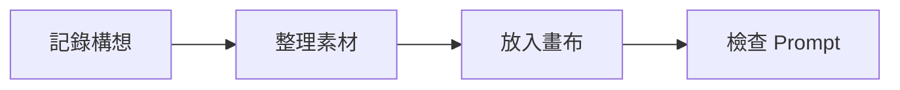

# 海岸散步

清晨沿著海岸散步，記下天空、浪花與人物的方向。這份筆記是可以修改的練習素材。

## 構圖與光線

| 項目 | 第一版 | 可以試的變化 |
|---|---|---|
| 時間 | 清晨 | 傍晚 |
| 構圖 | 寬景，低水平線 | 中景，人物偏左 |
| 光線 | 柔和側光 | 暖色逆光 |

> 先描述自己想看的畫面，再挑選能幫助表達的提示詞。

## 一次完整的練習

- [ ] 修改這份筆記的時間或光線
- [ ] 找到海岸場景的文字素材
- [ ] 將素材放進畫布
- [ ] 查看 Prompt 輸出
- [ ] 保存並重開文件

## 文字來源

```text
quiet coast, soft morning light, wide shot
```

用 **粗體** 標出主要方向，用 *斜體* 記錄待確認的想法。相關段落可放到 [構想補充](參考/構想補充.md)。

## 公式與流程圖

這是格式練習用的公式，不代表模型的實際計算：

$$
w_{\text{scene}} + w_{\text{light}} = 1
$$



## 本機圖片

下面使用隨教材提供的介面截圖，練習圖片顯示與相對路徑。


## 繼續操作

回到 [教學導覽](00-從這裡開始.md)，或開啟 [操作練習](05-操作練習.md)。
